<p align="center"></p>

<h3 align="center">Press <kbd>`</kbd> on any node. What comes next is already there.</h3>

<p align="center">A hotbox for ComfyUI · free and open source · no dependencies</p>

<p align="center">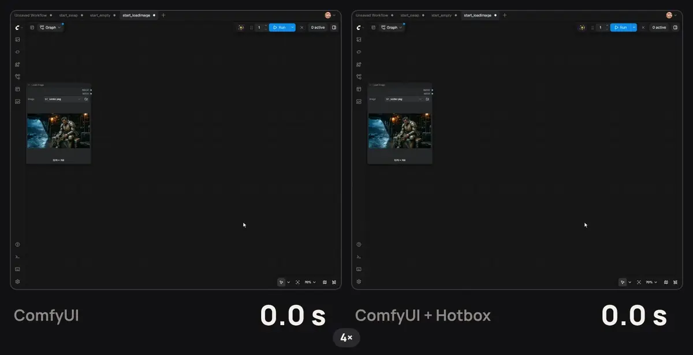</p>

## Installation

Search **Hotbox** in ComfyUI Manager, or:

```bash
cd ComfyUI/custom_nodes
git clone https://github.com/jorge-miranda-cherem/comfyui-hotbox.git
```

Restart ComfyUI and press <kbd>`</kbd> over any node.

<p align="center">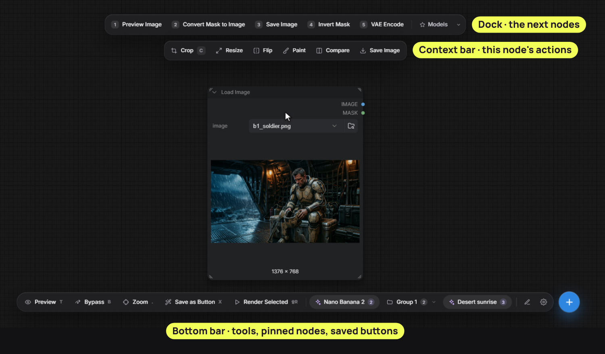</p>

## Key features

**Every action has a hotkey**

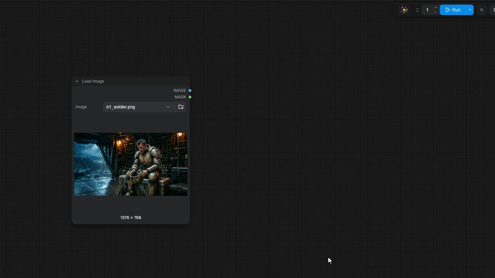

**Find any node**

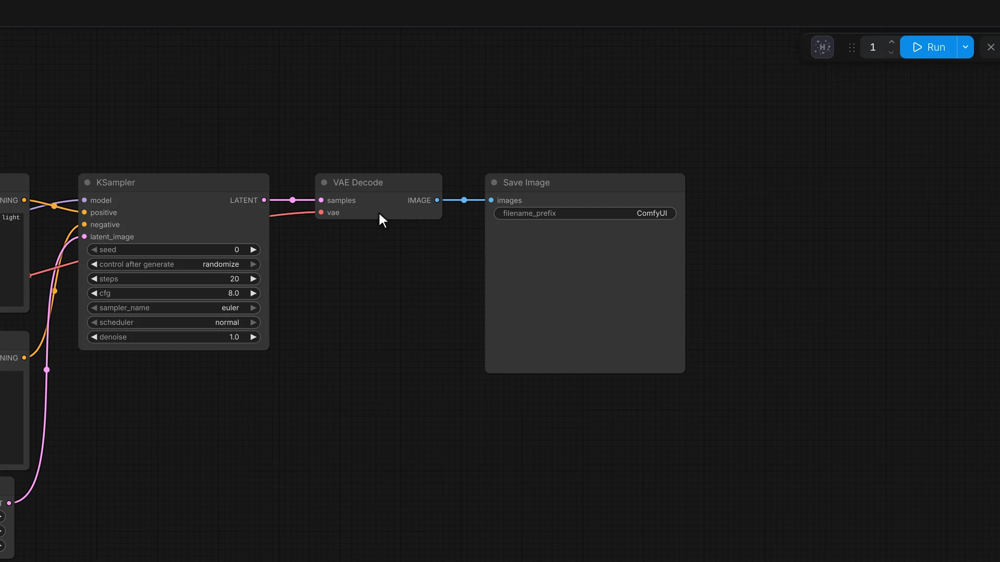

It ranks like ComfyUI's own search: ComfyUI's nodes first, a check on the ones that fit the node's output,
the pack's name beside a custom node. Typos and short forms (`previw`, `load img`, `ckpt`) still find it.
<kbd>↑</kbd> <kbd>↓</kbd> pick one and <kbd>Enter</kbd> adds it, already wired.

**Swap the model, keep the prompt**

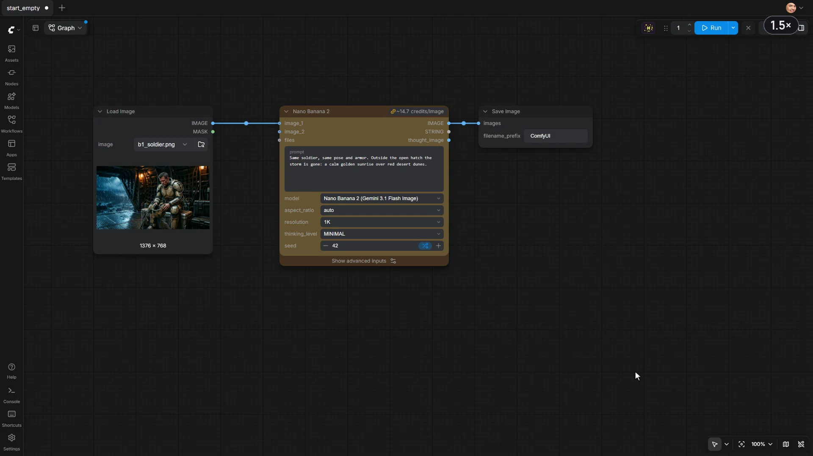

Subgraphs with a model inside swap the same way: an API model to a local pipeline (your own subgraphs, or ComfyUI's
ready-made ones), and back.

**Swap a whole batch at once**

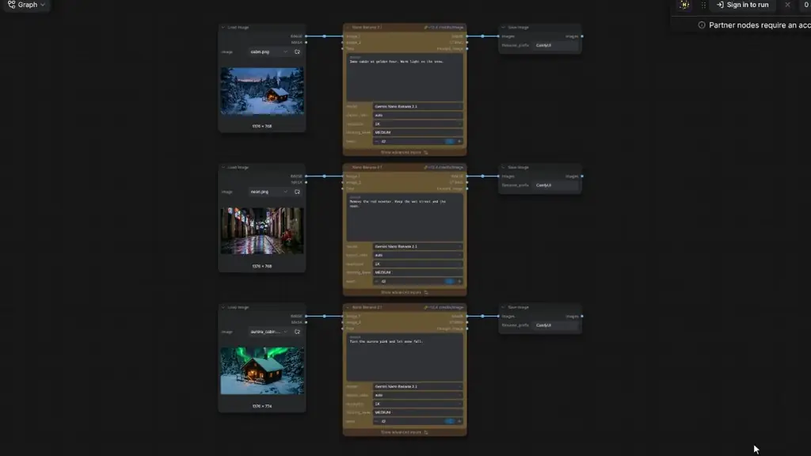

**Save any chain as a button**

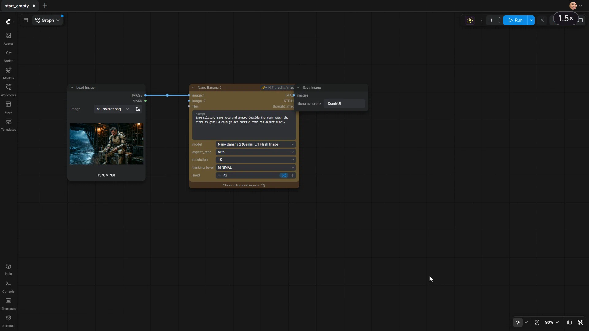

**Buttons snap together**

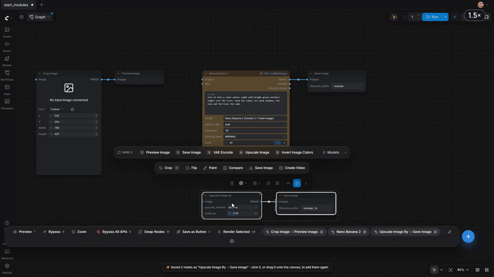

Saved buttons can live in a shared folder too (a studio drive, one per show), so a team builds one library together.

**Make it yours**

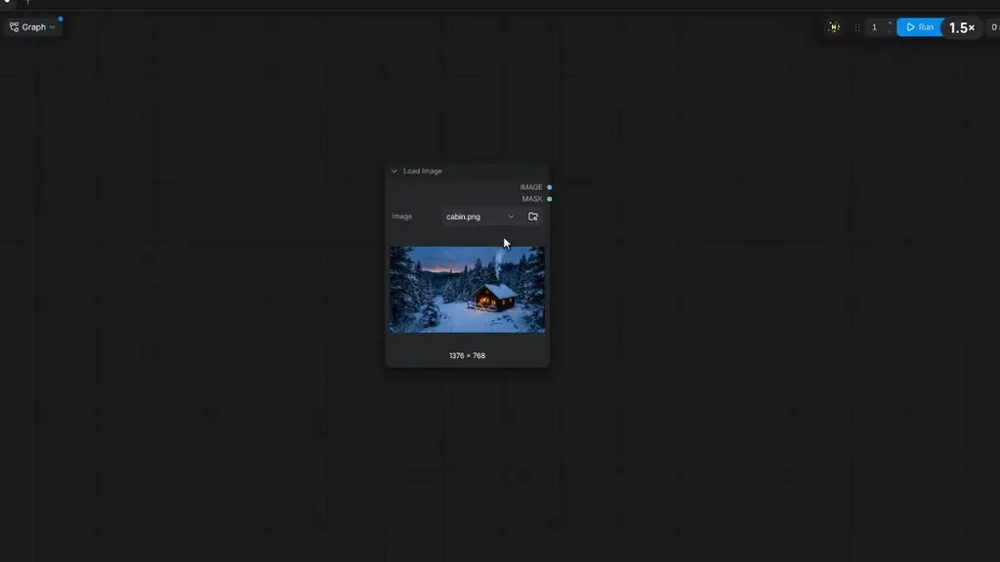

**Color your buttons**

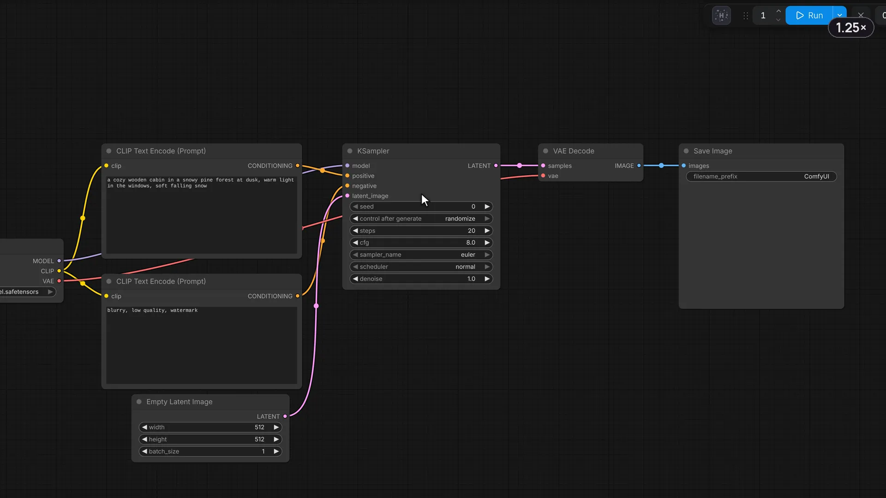

In edit mode, tap a button to rename it or give it a color: on its mark only, or on the whole button.

**Put any tool anywhere**

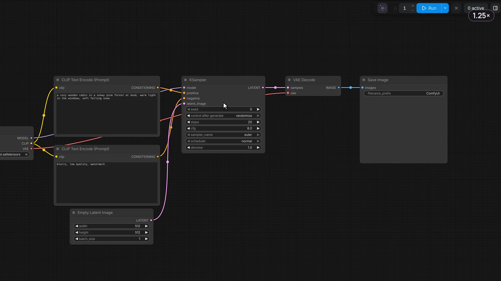

Drag a button from one bar to another, or a power tool straight out of Settings. It stays where you put it, and
where it does not apply it is dimmed.

**One setup per project**

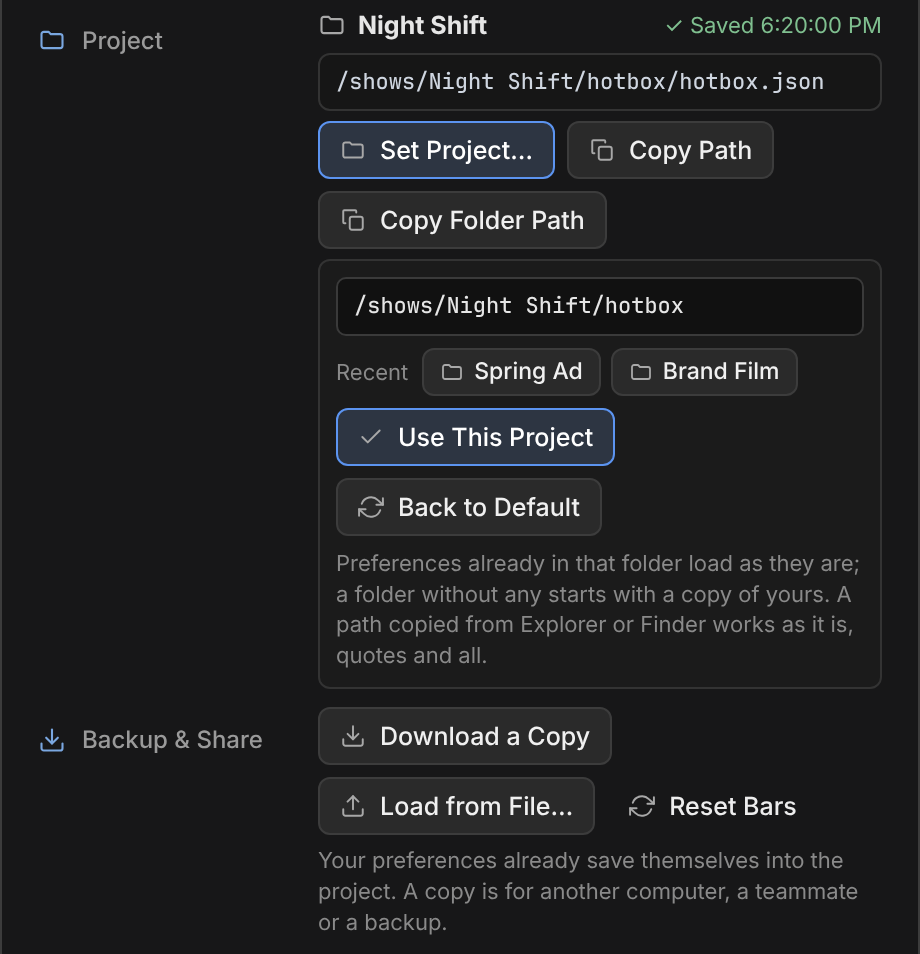

Everything you change is saved to a `hotbox.json`. **Set Project** points Hotbox at another folder (one per show,
a synced drive, a team folder), and your recent projects are one click away. **Download a Copy** and
**Load from File** take it to another computer or a teammate.

## More

[Tutorial](TUTORIAL.md) · [Reference](docs/REFERENCE.md) · [Custom Bar](CUSTOM_BAR.md) · [MIT License](LICENSE)
