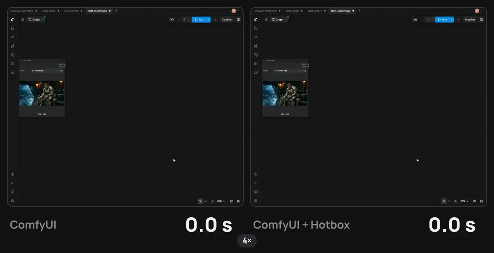
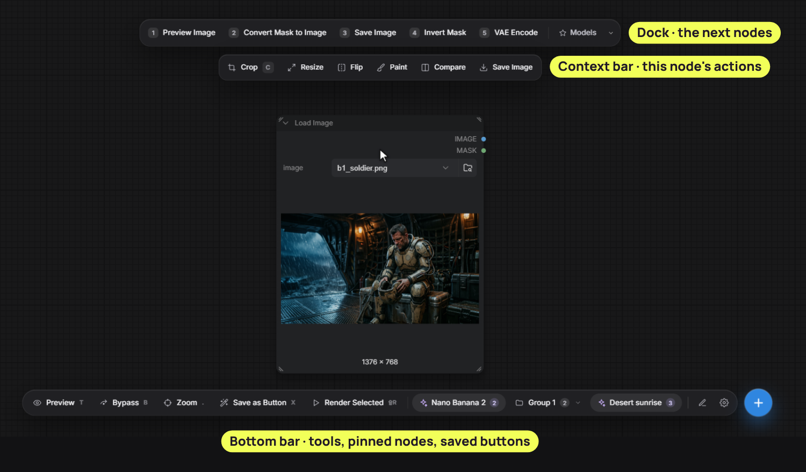
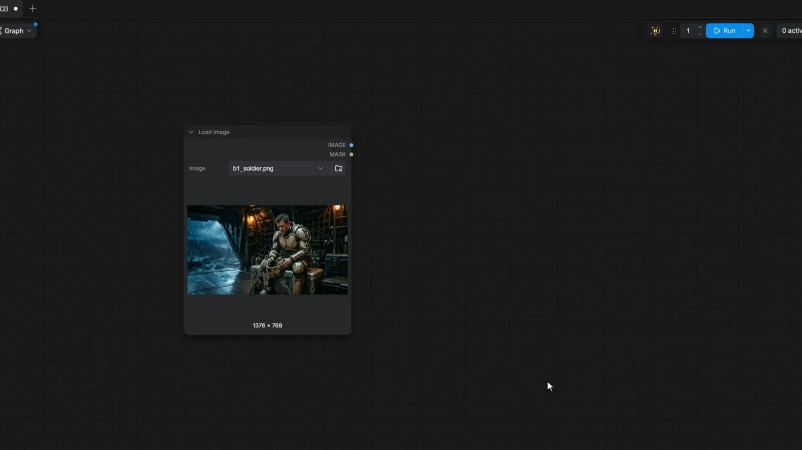
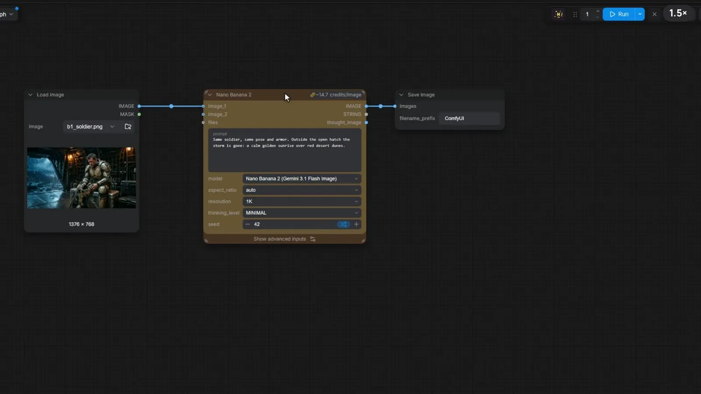
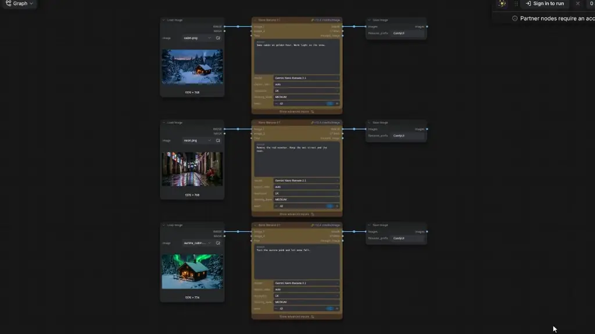
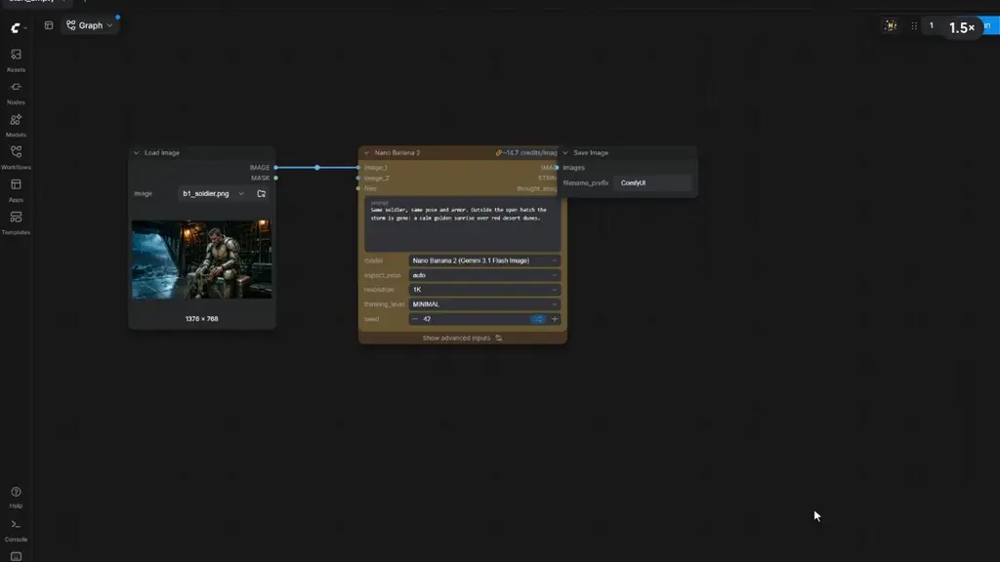
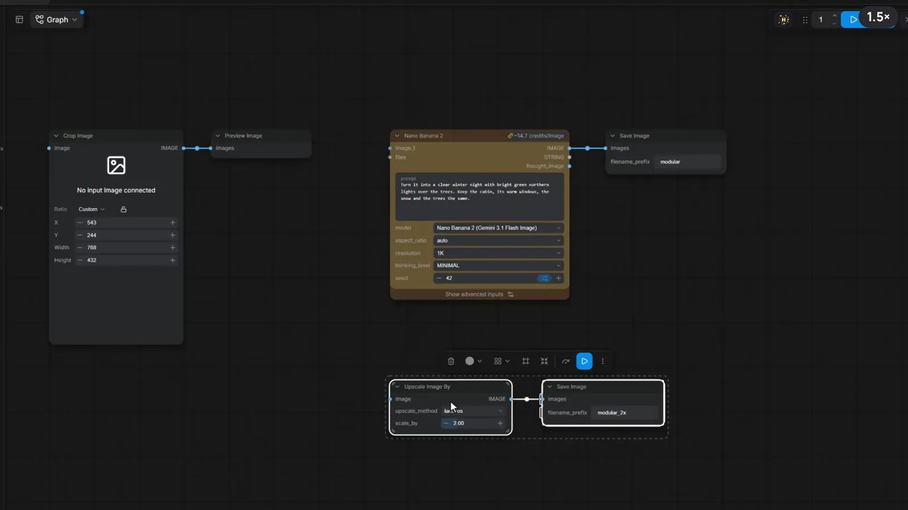
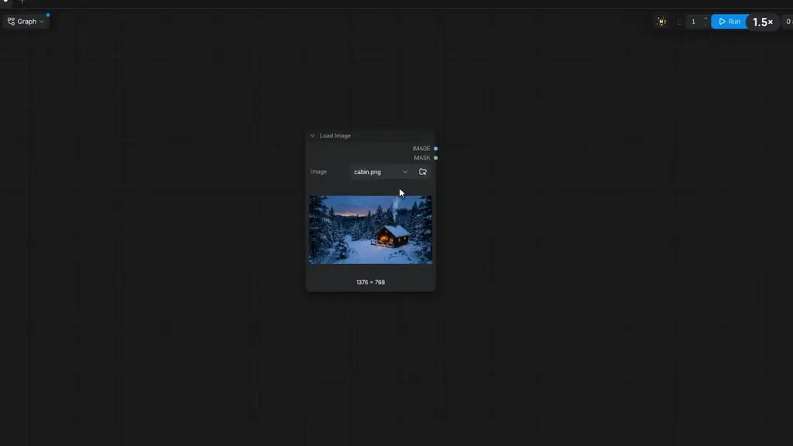

<p align="center"></p>

<h3 align="center">Press <kbd>`</kbd> on any node. What comes next is already there.</h3>

<p align="center">A hotbox for ComfyUI · free and open source · no dependencies</p>

<p align="center"></p>

## Installation

Search **Hotbox** in ComfyUI Manager, or:

```bash
cd ComfyUI/custom_nodes
git clone https://github.com/jorge-miranda-cherem/comfyui-hotbox.git
```

Restart ComfyUI and press <kbd>`</kbd> over any node.

<p align="center"></p>

## Key features

**Every action has a hotkey**



**Swap the model, keep the prompt**



Subgraphs with a model inside swap the same way: an API model to a local pipeline (your own subgraphs, or ComfyUI's
ready-made ones), and back.

**Swap a whole batch at once**



**Save any chain as a button**



**Buttons snap together**



**Make it yours**



## More

[Tutorial](TUTORIAL.md) · [Reference](docs/REFERENCE.md) · [Custom Bar](CUSTOM_BAR.md) · [MIT License](LICENSE)
