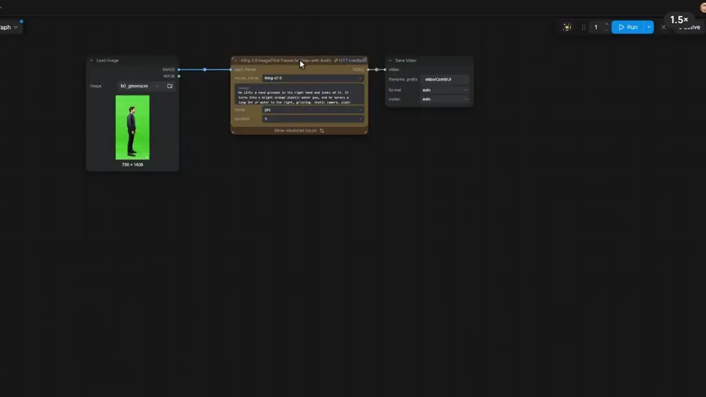
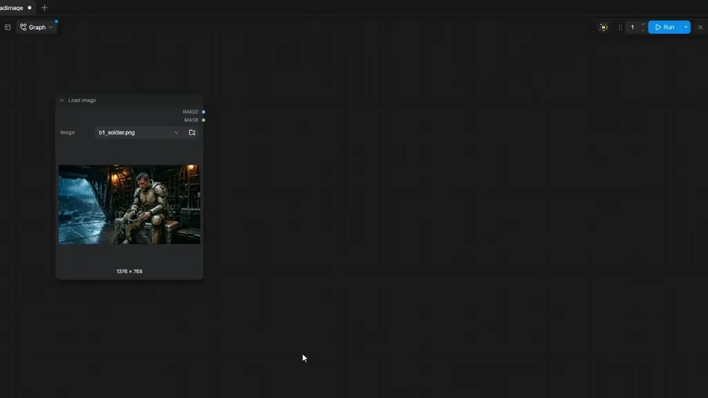
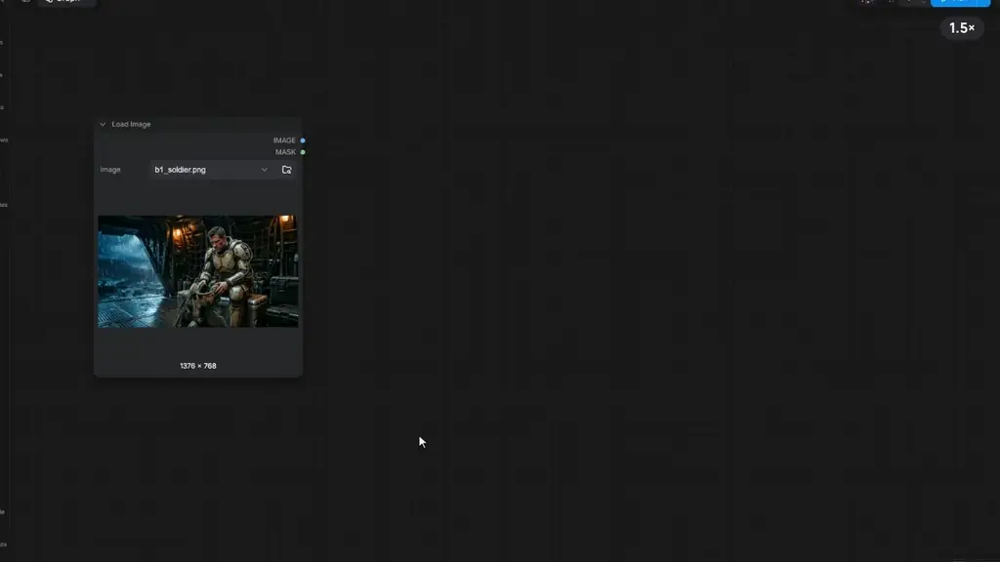

<p align="center"></p>

<h3 align="center">Press <kbd>`</kbd> on any node. What comes next is already there.</h3>

<p align="center">A Maya / Nuke-style hotbox for ComfyUI: the next nodes, the node's own actions and your saved buttons, around your cursor.<br>Free and open source · no dependencies · works with Nodes 2.0 and the classic canvas.</p>

<p align="center"></p>
<p align="center"><sub>The same workflow built twice, timed from the recordings: 37.9 s in ComfyUI, 23.8 s with Hotbox (played at 4×).</sub></p>

---

## 📦 Installation

**ComfyUI Manager:** search for **Hotbox** and install.

**Or by hand:**

```bash
cd ComfyUI/custom_nodes
git clone https://github.com/jorge-miranda-cherem/comfyui-hotbox.git
```

Restart ComfyUI, refresh the browser, and press <kbd>`</kbd> over any node. The **H** in the top bar opens Settings.

> Upgrading from *Super Hotbox*? Your settings are picked up automatically. Remove the old `super_hotbox` folder from `custom_nodes`.

---

## 🧭 Three bars

<p align="center"></p>

- **Dock**: the nodes that fit next, numbered. Press <kbd>1</kbd>–<kbd>5</kbd> and the node lands already wired.
- **Context bar**: the actions for the node you're on (Crop, Resize, Paint, Compare…).
- **Bottom bar**: tools, the nodes you pinned and your saved buttons. Drag any node onto it to pin it.

---

## ✨ See it

### Every action has a hotkey


<kbd>`</kbd> opens it, a letter runs an action (<kbd>C</kbd> crops), <kbd>Shift</kbd>+<kbd>R</kbd> renders only what you selected.

### Swap the model, keep the prompt


On a model node the Dock's numbers swap it in place, and <kbd>A</kbd> finds any other model. The prompt and every shared setting come along.

### Video models too



Video models swap only to video models, with the prompt and settings still on board.

### Save as Button


<kbd>G</kbd> groups and names, <kbd>X</kbd> saves it as a button. One click brings the nodes back anywhere, settings and wires included.

### Buttons snap together like modules


Select a node and press a saved button: the block lands after it and plugs in. Small blocks chain into a whole pipeline.

### Set → Get, no wires



<kbd>S</kbd> puts a node's output on a bus; a paired Get takes it anywhere without a wire across the graph. Needs [KJNodes](https://github.com/kijai/ComfyUI-KJNodes) or Easy-Use.

### Your button library



Drop a button on another to group them, search the drawer for any saved button, drag one onto the canvas or onto a bar.

---

## 📚 Learn more

- **[Tutorial](TUTORIAL.md)**: nine short steps, including Visual Crop, Super Stitch and Paint Studio.
- **[Reference](docs/REFERENCE.md)**: every bar, shortcut and setting, and where your preferences are saved.
- **[Custom Bar](CUSTOM_BAR.md)**: put your own extension's controls in the hotbox.

## 📄 License

[MIT](LICENSE). The images in these recordings were generated through ComfyUI's partner nodes.
