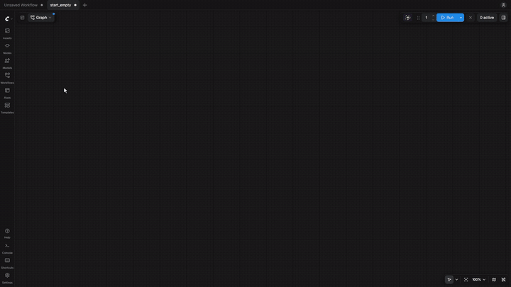
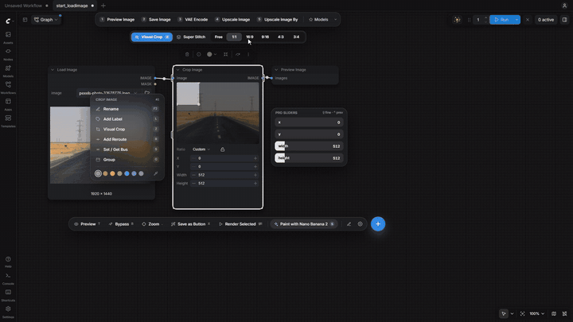
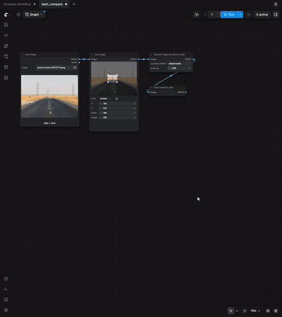
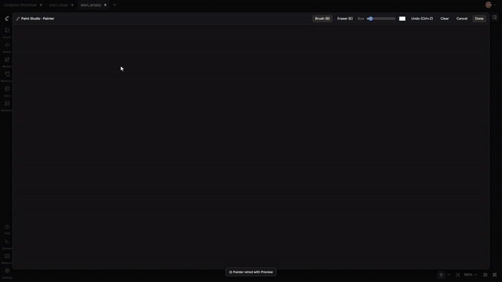
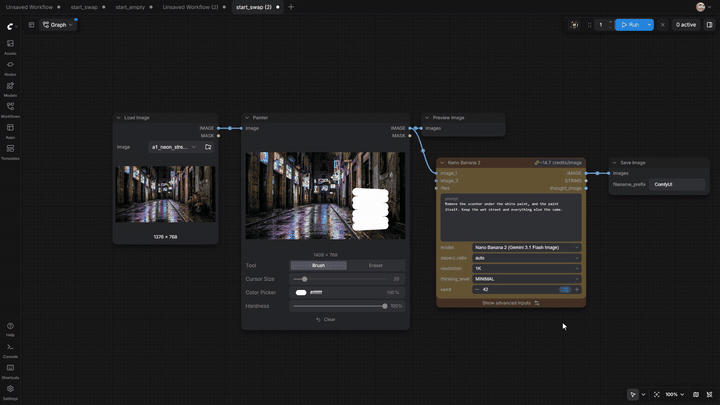
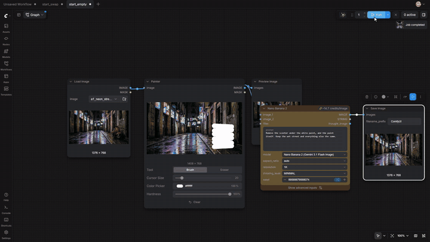
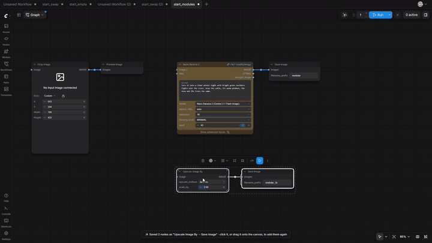
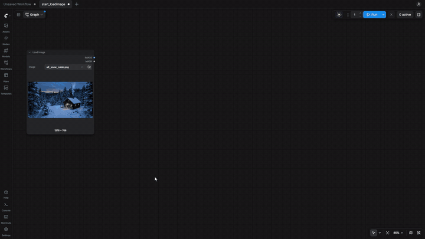
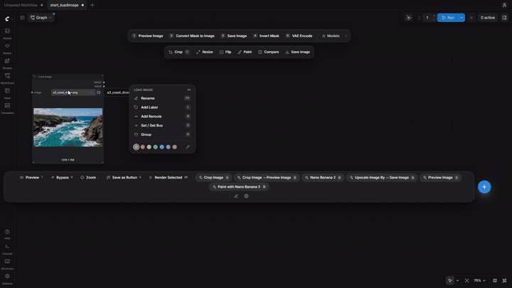

# Hotbox tutorial

Nine short steps, from your first key press to saved buttons that snap together like modules. Every animation is a
real-time recording of Hotbox in ComfyUI (Nodes 2.0); nothing is sped up. Install Hotbox first ([README](README.md#-installation)).

The names used below: the **Dock** is the numbered row on top, the **Context bar** the row of actions under it, the
**Bottom bar** the row of power tools and saved buttons, and the blue **+** opens the drawers.

---

## 1. Open it, add nodes, render

1. Point at the empty canvas and press <kbd>`</kbd>. The Dock offers nodes to start with; press <kbd>1</kbd> for **Load Image**.
2. Point at the new node and press <kbd>`</kbd> again. The Context bar now holds the actions for an image: press
   <kbd>C</kbd> (its first action, **Crop**) and a crop with its preview is added, already wired.
3. Press <kbd>Shift</kbd>+<kbd>R</kbd> (**Render Selected**) to run only the selected node's outputs.
4. While the hotbox is open, <kbd>Tab</kbd> switches style (Fluid → Compact → Quiet) and <kbd>.</kbd> frames the selection.

Every key works on the node under the cursor or the selected one, so a whole graph can be built without menus.

## 2. Crop visually

1. On a crop node, open the hotbox: the Context bar shows **Visual Crop** and the ratios (`Free · 1:1 · 16:9 · 9:16 · 4:3 · 3:4`).
2. Pick a ratio, then **Visual Crop** (<kbd>Alt</kbd>+<kbd>Z</kbd>): lock the ratio, drag a corner to resize, drag inside to move.
3. <kbd>Enter</kbd> (or **Done**) writes the box into the node. <kbd>Shift</kbd>+<kbd>R</kbd> renders it.

## 3. Put an edit back where it was cut — Super Stitch

1. Select the node that holds your edited crop (the output of any model or effect fed by a crop).
2. Open the hotbox: **Super Stitch** is the first button there. Press it.
3. It adds a fit that scales your result back to the crop's size and a composite that pastes it on the plate at the
   crop's `x / y`, plugs your result in, and brings the new nodes into view. Press **Run**.

The stitch keeps following its crop: move or resize the crop box and the paste position follows.

## 4. Paint, then hand it to any model

1. On a **Load Image**, press **Paint** in the Context bar: a Painter node and its preview are added.
2. With the Painter selected, <kbd>Alt</kbd>+<kbd>Z</kbd> opens **Paint Studio**: brush, eraser, size, color, undo.
   <kbd>Enter</kbd> saves the paint into the node.
3. Open the hotbox on the Painter and press <kbd>A</kbd> (**Models & APIs**), type a name (`nano banana 2`) and click
   it: the model is added and wired to the Painter's image.
4. <kbd>Alt</kbd>+<kbd>Z</kbd> on the model opens the **Magnifier**, a big prompt editor. Write the prompt, <kbd>Esc</kbd>.
5. Open the hotbox on the model: **Save Image** comes first. Then **Run**.

## 5. Swap the model, keep the prompt

On a model node, the Dock's numbers swap the model in place (<kbd>A</kbd> + a search reaches any other one). The new
node takes the old one's spot, its links, and every setting they share (`prompt`, `seed`, `aspect_ratio`…). Try the same
prompt on five models in a few seconds, then **Run** the one you like.

## 6. Group it and save it as a button

1. Click the canvas, <kbd>Ctrl</kbd>+<kbd>A</kbd>, open the hotbox and press <kbd>G</kbd>: the nodes are grouped and the
   title editor opens; type a name, <kbd>Enter</kbd>.
2. Click the group's title, open the hotbox and press <kbd>X</kbd> (**Save as Button**): the group melts into a button
   in the Bottom bar, named after the group. The nodes stay where they are.
3. In any workflow, open the hotbox and click the button (or drag it onto the canvas): the nodes, their settings,
   their wires and the group come back.

## 7. Buttons are modules: they plug into the selected node

Save small blocks as buttons — `Crop → Preview`, `Nano Banana 2 → Save`, `Upscale ×2 → Save` — then chain them:

1. Select a node (a **Load Image**), open the hotbox and press a saved button.
2. The block lands right after the selected node and its first open input takes that node's output
   (the status line says `plugged into …`).
3. Select the new block's node and press the next button. Build a whole pipeline this way, then **Run**.

A button whose block starts with its own loader (like a full workflow) is just added, not plugged in.

## 8. Send anything anywhere — Set / Get buses

Needs [KJNodes](https://github.com/kijai/ComfyUI-KJNodes) or Easy-Use (their Set / Get nodes).

1. Point at a node, open the hotbox and press <kbd>S</kbd>: a **Set** node is added, wired and named after it.
2. On the Set node, **Paired Get** adds a Get on the same bus. Put it anywhere; no wire crosses the graph.
3. On a Get node, the Context bar lists every bus in the workflow: click one to switch the Get to it.
4. On the bare canvas, the left card lists a Get for every bus, dropped where you opened the hotbox.

## 9. Your library of saved buttons

- **Group buttons**: drag a button onto the middle of another. Hover the group to see its list; its arrow keeps it open.
- **Find any button**: press <kbd>N</kbd> and type — saved buttons have their own section in the drawer.
- **Drag a button onto the canvas** to add its nodes there, or **onto a bar** to pin it to that bar.
- **Manage them** in **Settings → Saved Buttons** (rename in edit mode, delete with two clicks on the trash).

Saved buttons live in your preferences file (`hotbox.json`), so they survive restarts and can be shared.

---

## Keys at a glance

| Key | In the hotbox |
| :--- | :--- |
| <kbd>`</kbd> | Open / close (rebindable) |
| <kbd>1</kbd>–<kbd>9</kbd> | Dock buttons: add & wire the next node, or swap a model |
| <kbd>C</kbd> | The Context bar's first action |
| <kbd>F</kbd> · <kbd>N</kbd> · <kbd>A</kbd> · <kbd>U</kbd> | Drawers: all nodes · image/video kit · models & APIs · subgraphs |
| <kbd>T</kbd> · <kbd>S</kbd> · <kbd>R</kbd> · <kbd>L</kbd> · <kbd>F2</kbd> | Preview · Set bus · Reroute · Label · Rename |
| <kbd>G</kbd> · <kbd>X</kbd> · <kbd>W</kbd> | Group · Save as Button · Swap two selected nodes |
| <kbd>B</kbd> · <kbd>M</kbd> · <kbd>P</kbd> · <kbd>K</kbd> | Bypass · Mute · Seed mode · Bypass all API nodes |
| <kbd>Z</kbd> / <kbd>Alt</kbd>+<kbd>Z</kbd> | Magnifier · Visual Crop · Paint Studio |
| <kbd>.</kbd> | Frame the selection (again to return) |
| <kbd>Tab</kbd> · <kbd>Esc</kbd> | Switch style · close |
| <kbd>Shift</kbd>+<kbd>R</kbd> | Render only the selected outputs (works with the hotbox closed) |
| <kbd>Alt</kbd>+<kbd>R</kbd> · <kbd>Alt</kbd>+<kbd>N</kbd> | Load in Canvas · Label Studio |

---

The plates in these recordings are a [Pexels](https://www.pexels.com/photo/endless-desert-highway-with-power-lines-33678776/)
photo (Pexels License) and images generated with Nano Banana 2 through ComfyUI's partner nodes.
