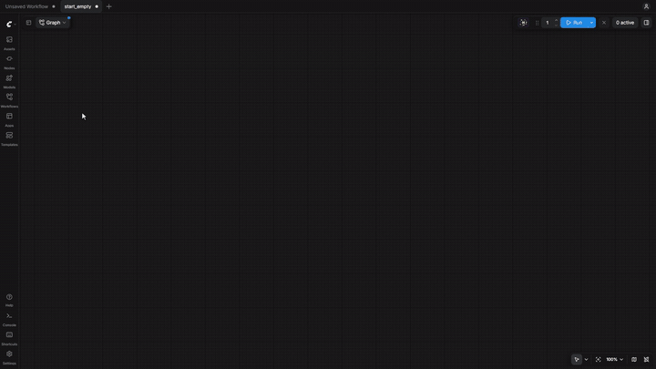
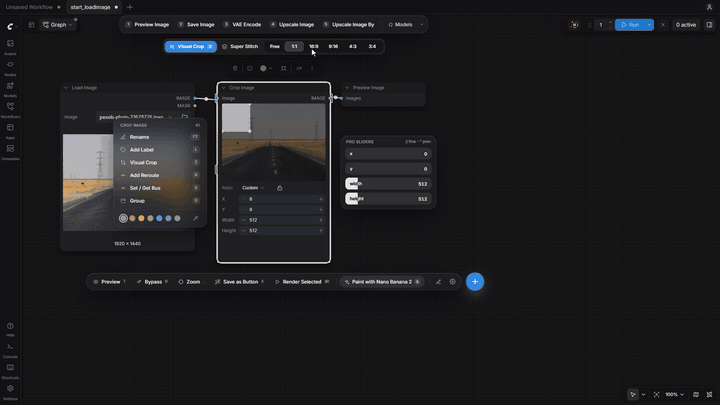
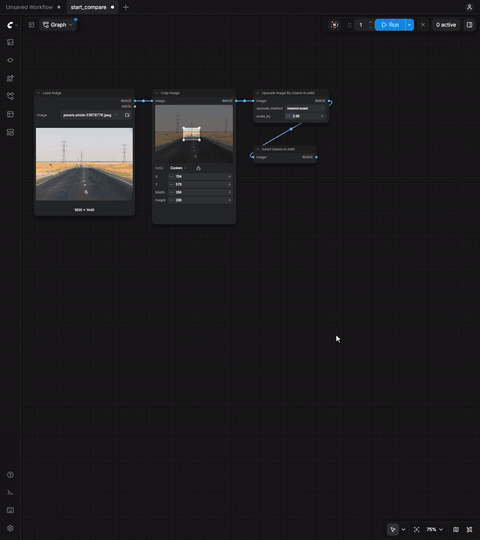
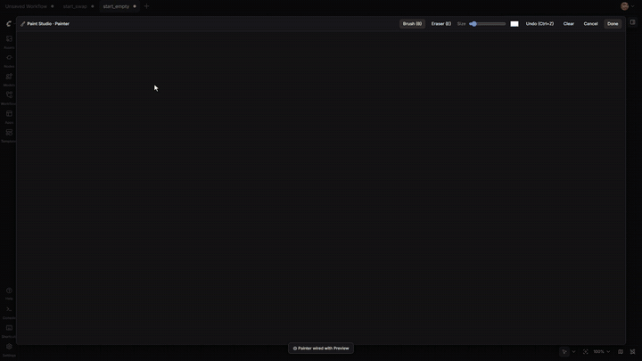
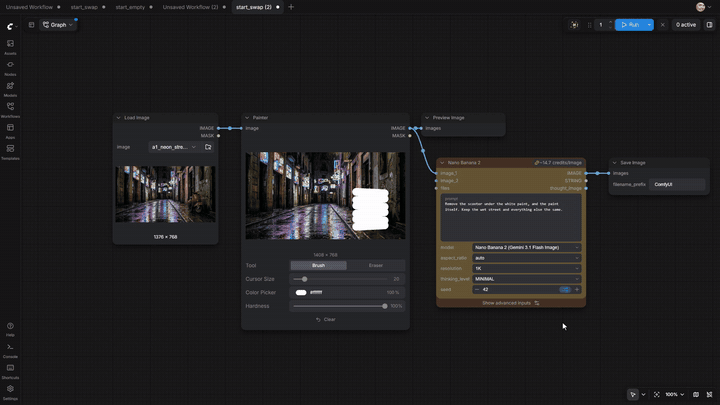
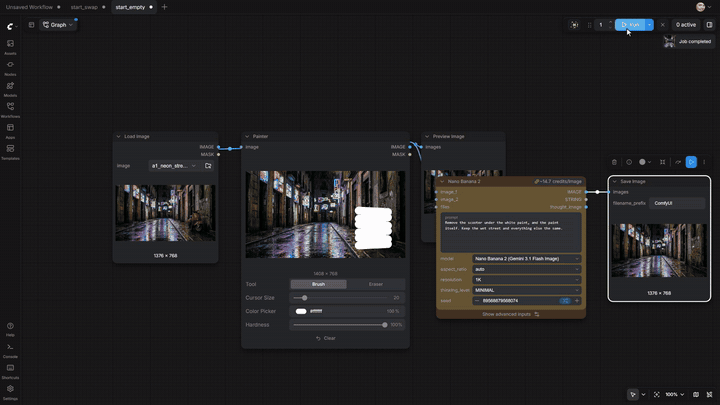
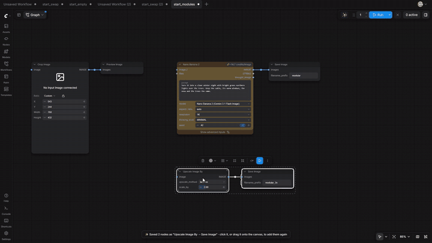
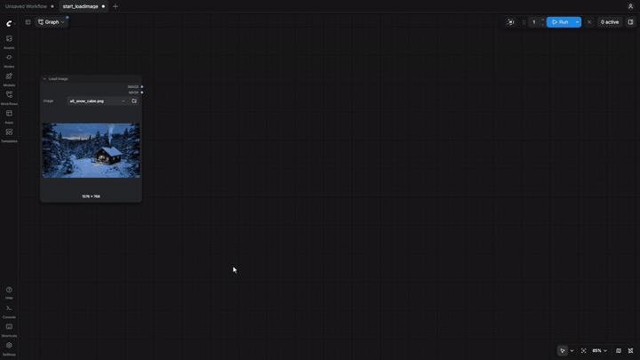
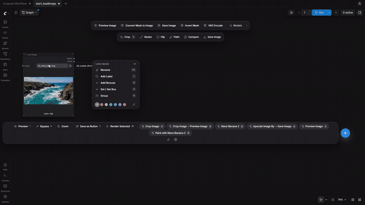
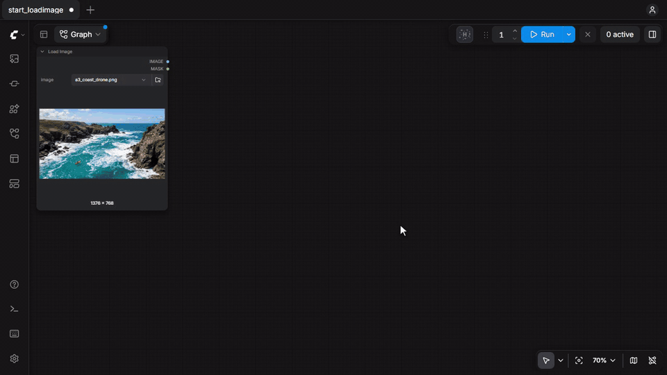

# Hotbox tutorial

Nine short steps, from your first key press to saved buttons that snap together like modules. Every animation is a
real-time recording of Hotbox in ComfyUI (Nodes 2.0); nothing is sped up. Install Hotbox first ([README](README.md#-installation)).

The names used below: the **Dock** is the numbered row on top, the **Context bar** the row of actions under it, the
**Bottom bar** the row of power tools and saved buttons, and the blue **+** opens the drawers.

---

## 1. Open it, add nodes, render

1. Point at the empty canvas and press <kbd>`</kbd>. The Dock offers nodes to start with; press <kbd>1</kbd> for **Load Image**.
2. Point at the new node and press <kbd>`</kbd> again. The Context bar now holds the actions for an image: press
   <kbd>C</kbd> (its first action, **Crop**) and a crop with its preview is added, already wired.
3. Press <kbd>Shift</kbd>+<kbd>R</kbd> (**Render Selected**) to run only the selected node's outputs.
4. While the hotbox is open, <kbd>Tab</kbd> switches style (Compact, the one it starts with → Quiet → Fluid) and <kbd>.</kbd> frames the selection.

Every key works on the node under the cursor or the selected one, so a whole graph can be built without menus.

## 2. Crop visually

1. On a crop node, open the hotbox: the Context bar shows **Visual Crop** and the ratios (`Free · 1:1 · 16:9 · 9:16 · 4:3 · 3:4`).
2. Pick a ratio, then **Visual Crop** (<kbd>Alt</kbd>+<kbd>Z</kbd>): lock the ratio, drag a corner to resize, drag inside to move.
3. <kbd>Enter</kbd> (or **Done**) writes the box into the node. <kbd>Shift</kbd>+<kbd>R</kbd> renders it.

## 3. Put an edit back where it was cut — Super Stitch

1. Select the node that holds your edited crop (the output of any model or effect fed by a crop).
2. Open the hotbox: **Super Stitch** is the first button there. Press it.
3. It adds a fit that scales your result back to the crop's size and a composite that pastes it on the plate at the
   crop's `x / y`, plugs your result in, and brings the new nodes into view. Press **Run**.

The stitch keeps following its crop: move or resize the crop box and the paste position follows.

## 4. Paint, then hand it to any model

1. On a **Load Image**, press **Paint** in the Context bar: a Painter node and its preview are added.
2. With the Painter selected, <kbd>Alt</kbd>+<kbd>Z</kbd> opens **Paint Studio**: brush, eraser, size, color, undo.
   <kbd>Enter</kbd> saves the paint into the node.
3. Open the hotbox on the Painter and press <kbd>A</kbd> (**Models & APIs**), type a name (`nano banana 2`) and click
   it: the model is added and wired to the Painter's image.
4. <kbd>Alt</kbd>+<kbd>Z</kbd> on the model opens the **Magnifier**, a big prompt editor. Write the prompt, <kbd>Esc</kbd>.
5. Open the hotbox on the model: **Save Image** comes first. Then **Run**.

## 5. Swap the model, keep the prompt

On a model node, the Dock's numbers swap the model in place (<kbd>A</kbd> + a search reaches any other one). The new
node takes the old one's spot, its links, and every setting they share (`prompt`, `seed`, `aspect_ratio`…). Try the same
prompt on five models in a few seconds, then **Run** the one you like.

Subgraphs swap the same way. A subgraph with a model inside (an API node, or a loader of a local model) shows up under
**Subgraphs** in the <kbd>A</kbd> drawer: your own, then ComfyUI's ready-made ones (Text to Image, Image Edit, Image to
Video…). Swap an API model to a local pipeline and back, or one subgraph to another, prompt and links included. On such a
subgraph the hotbox opens in swap mode too.

## 6. Group it and save it as a button

1. Click the canvas, <kbd>Ctrl</kbd>+<kbd>A</kbd>, open the hotbox and press <kbd>G</kbd>: the nodes are grouped and the
   title editor opens; type a name, <kbd>Enter</kbd>.
2. Click the group's title, open the hotbox and press <kbd>X</kbd> (**Save as Button**): the group melts into a button
   in the Bottom bar, named after the group. The nodes stay where they are. (Select a label along with the nodes
   and the button takes the label's text as its name instead.)
3. In any workflow, open the hotbox and click the button (or drag it onto the canvas): the nodes, their settings,
   their wires and the group come back.

## 7. Buttons are modules: they plug into the selected node

Save small blocks as buttons — `Crop → Preview`, `Nano Banana 2 → Save`, `Upscale ×2 → Save` — then chain them:

1. Select a node (a **Load Image**), open the hotbox and press a saved button.
2. The block lands right after the selected node and its first open input takes that node's output
   (the status line says `plugged into …`).
3. Select the new block's node and press the next button. Build a whole pipeline this way, then **Run**.

A button whose block starts with its own loader (like a full workflow) is just added, not plugged in.

## 8. Send anything anywhere — Set / Get buses

Needs [KJNodes](https://github.com/kijai/ComfyUI-KJNodes) or Easy-Use (their Set / Get nodes).

1. Point at a node, open the hotbox and press <kbd>S</kbd>: a **Set** node is added, wired and named after it.
2. On the Set node, **Paired Get** adds a Get on the same bus. Put it anywhere; no wire crosses the graph.
3. On a Get node, the Context bar lists every bus in the workflow: click one to switch the Get to it.
4. On the bare canvas, the left card lists a Get for every bus, dropped where you opened the hotbox.

## 9. Your library of saved buttons

- **Group buttons**: drag a button over the middle of another and rest there until it lights up, then let go. Hover the group to see its list; its arrow keeps it open until the hotbox closes. More in [section 10](#10-move-and-group-your-buttons).
- **Find any button**: press <kbd>N</kbd> and type — saved buttons have their own section in the drawer.
- **Drag a button onto the canvas** to add its nodes there, or **onto a bar** to pin it to that bar.
- **Share them**: **Settings → Shared Libraries → Add Folder** adds a team folder (a studio drive, one per show). Its
  buttons show up in the drawer beside yours; make it **Writable** and **Save Here** and the buttons you save go there
  for everyone. See [shared libraries](docs/REFERENCE.md#%EF%B8%8F-shared-libraries).

Saved buttons live in your preferences file (`hotbox.json`), so they survive restarts and can be shared.

## 10. Move and group your buttons

1. **Drag any button**, with no need to hold it first. It lifts from the point you took it by; nothing in the bars moves while it is in your hand, and a bright line marks where it will land.
2. **Into a group**: take it to the middle of the group, which lights up. Rest there and its list opens: pick the place in it, the first one too.
3. **Two buttons, one group**: rest a button on the middle of another until it lights up, and let go.
4. **Take one off the bar**: hold a button (or click the ✎) for edit mode, then drag it to the red **Remove** strip. <kbd>Ctrl</kbd>+<kbd>Z</kbd> puts it back, and only that: the canvas keeps its own undo.
5. Let go away from the bars, or press <kbd>Esc</kbd>, and the button goes back where it was.

## 11. The button editor

1. **Settings → Saved Buttons → Browse…** (the **H** in ComfyUI's top bar opens Settings).
2. On top, **your bottom bar** as the hotbox shows it. Under it, a lane for every group and one for the buttons in no group.
3. **Click a button**: its name, color, icon and hotkey are on the right, with the group it is in and the nodes it adds. The hotkey warns when the key already does something.
4. **Drag** a card to any place in a lane, onto a group in the bar, or onto **New group** (<kbd>G</kbd> makes one too). Drag a group or a button along the bar to move it there.
5. Every change saves itself. <kbd>Ctrl</kbd>+<kbd>Z</kbd> takes it back, <kbd>Ctrl</kbd>+<kbd>Shift</kbd>+<kbd>Z</kbd> does it again, <kbd>/</kbd> finds a button by its name or by a node in it, <kbd>Del</kbd> deletes what is picked.

## 12. Send a button to someone

1. Pick a saved button or a group in the button editor (or right-click it in the hotbox) and press **Copy to share**. It is on your clipboard as text, nodes and all.
2. Paste it into any chat or mail.
3. Whoever gets it copies the whole message and presses <kbd>Ctrl</kbd>+<kbd>V</kbd> anywhere in ComfyUI. A card shows what it holds; **Add to my buttons** puts it at the end of their bottom bar.
4. Nothing they have is overwritten: what arrives is kept as the next version of their preferences. A group they already have keeps the buttons they put in it, and the new ones go after them. (In the recording one ComfyUI plays both sides: the button is deleted in between.)

## 13. A key of its own, and new nodes for the same button

1. **Right-click a button → Key**, and press the key that runs it while the hotbox is open. Here <kbd>Q</kbd> adds the button's nodes.
2. **Right-click → Edit its nodes…**: pick a node, change a value, a title or how it runs, and **Save to this button**. It stays where it is, with its name, color and key.
3. Or change the nodes on the canvas, select them, and choose **Use selection** in the same box.
4. What the button held before is kept behind it (the last five): **Versions…** in that editor brings one back.

---

## Keys at a glance

| Key | In the hotbox |
| :--- | :--- |
| <kbd>`</kbd> | Open / close (rebindable) |
| <kbd>1</kbd>–<kbd>9</kbd> | Dock buttons: add & wire the next node, or swap a model |
| <kbd>C</kbd> | The Context bar's first action |
| <kbd>F</kbd> · <kbd>N</kbd> · <kbd>A</kbd> · <kbd>U</kbd> | Drawers: all nodes · image/video kit · models & APIs · subgraphs |
| <kbd>T</kbd> · <kbd>S</kbd> · <kbd>R</kbd> · <kbd>L</kbd> · <kbd>F2</kbd> | Preview · Set bus · Reroute · Label · Rename |
| <kbd>G</kbd> · <kbd>X</kbd> · <kbd>W</kbd> | Group · Save as Button · Swap two selected nodes |
| <kbd>B</kbd> · <kbd>M</kbd> · <kbd>P</kbd> · <kbd>K</kbd> | Bypass · Mute · Seed mode · Bypass all API nodes |
| <kbd>Z</kbd> / <kbd>Alt</kbd>+<kbd>Z</kbd> | Magnifier · Visual Crop · Paint Studio |
| <kbd>.</kbd> | Frame the selection (again to return) |
| <kbd>Tab</kbd> · <kbd>Esc</kbd> | Switch style · close |
| <kbd>Shift</kbd>+<kbd>R</kbd> | Render only the selected outputs (works with the hotbox closed) |
| <kbd>L</kbd> (hotbox closed) | Arrange the selection along its wires, as Nuke's <kbd>L</kbd> does; on one node, line it up with what feeds it |
| <kbd>Alt</kbd>+<kbd>R</kbd> · <kbd>Alt</kbd>+<kbd>N</kbd> | Load in Canvas · Label Studio |

---

The plates in these recordings are a [Pexels](https://www.pexels.com/photo/endless-desert-highway-with-power-lines-33678776/)
photo (Pexels License) and images generated with Nano Banana 2 through ComfyUI's partner nodes.
