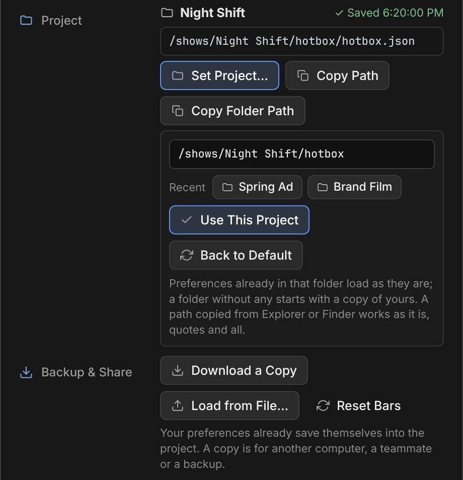

# Hotbox reference

Everything Hotbox does, bar by bar. For a quick look start with the [README](../README.md); for a step-by-step walk, the [tutorial](../TUTORIAL.md).

---

## ✨ Highlights

- **Three styles** (switch live with <kbd>Tab</kbd>):
  - **Compact** (default) — the Fluid look and motion, bars only (no side cards).
  - **Fluid** — frosted glass panels, spring motion that blooms from the cursor, sliding hover highlights and smooth sliders.
  - **Quiet** — native ComfyUI panels, monospace key hints, fast fades (optional leader lines from the cursor to each zone).
- **The big blue `+`** sits right beside the bottom bar. Hover it and the four categories fan out (`All Nodes F` · `Image / Video Kit N` · `Models & APIs A` · `Subgraphs U`); click it for All Nodes. Drag any result onto any bar to pin it, or **drop it on the `+`** to pin it to the bottom bar.
- **A search that ranks like ComfyUI's.** The drawer's search grades each node the way ComfyUI's own search box does (the whole name, its start, a whole word, part of a word, every word you typed), then puts ComfyUI's own nodes before custom ones, the nodes that take the node's outputs next (with their slot shown, `IMAGE`), then the ones people use most (the popularity list ComfyUI ships). Typos (`previw`), short forms (`load img`, `ckpt`, `i2v`), the first letters of its words (`vd` for VAE Decode, `clte` for CLIP Text Encode; up to four letters of a word, or the whole word: `loadlora`) and the node's search aliases still find it; a name that holds what you typed at the start of a word comes before those initials, and one that only holds it inside a word (`vd` in SVD) after them. A custom node shows its pack's name beside it. <kbd>↑</kbd> <kbd>↓</kbd> pick a result, <kbd>Enter</kbd> adds it, <kbd>Esc</kbd> clears the search, then closes the drawer.
- **A search that learns what you use.** Three things lift a node in that list. A **star**: the ☆ at the end of a row, or <kbd>Ctrl</kbd>+<kbd>Enter</kbd> on the row in hand, puts it first among the matches (ComfyUI runs the workflow on that key; in the search it only stars). **Your own use**: each node you add from the list counts, and an orange bar at the left of a row shows how much, against the one you add most. **The node you are on**: what you added after a node of that type counts double, and what the open graph already wires after one counts too; it is learned only when the new node ended up wired to it. A loose match gets a quarter of the lift, so a favorite never passes a node that is really called what you typed, and the whole name typed is always first. With nothing typed the list opens with **After** *this node*, **Favorites** and **Most used**, then the suggestions for what the node gives. It is kept in `hotbox.json` (`nodeMem`), so it follows you; with nothing remembered the order is the one above. **The stars are shared with ImissNuke's Tab menu** where it is installed: the two memories stay apart (ImissNuke's is this browser's, `localStorage` `imissnuke-tab-memory`), but the starred nodes of both are merged the first time and kept the same after, so a star put on or taken off in one shows in the other the next time its list opens. Only the stars are shared, and nothing is read or written where ImissNuke has left no memory.
- **Only the newest models.** Deprecated and legacy nodes never show up, and neither do older versions of a partner model when its newer one is installed: Kling 4.0 hides Kling 3.0 Omni, Kling 2.6 and the first Kling; Vidu Q4 hides Vidu2; Seedance 2.5 hides the first ByteDance video nodes; ComfyUI's Image to Video (LTX-2.5) subgraph hides the LTX-2.3 one. Type a version number to find an older one (`kling 2.6`). A button you already pinned stays, and local model nodes are never hidden (an older model on disk needs its own nodes).
- **A dock shortcut you choose.** The button at the end of the top dock opens one category (Models by default); its `▾` swaps it for the Kit, Subgraphs or All Nodes — or hides it.
- **Drag a node onto the bar to pin it.** Grab any node by its title while the hotbox is open and drop it on the bottom bar (or the `+`). The node stays where it was; its type becomes a one-click button for that context.
- **Save as Button.** Select any nodes (one or many, or a group) and press **Save as Button** (<kbd>X</kbd>): a copy of them melts into one button in the bottom bar, and the nodes themselves stay where they are. Click the button to add those nodes again by the cursor, or drag it onto the canvas to add them right there — settings and inner wires come back exactly as they were. The button is named after what the nodes do (`Flux · Text to Image`, `Wan · Image to Video`, `Upscale`…) and saved with the rest of your preferences. Select a label along with the nodes and the button takes the label's text as its name: the name you already wrote on the canvas (a Label Studio / rgthree label or a Pixaroma label; with several, the top one). A titled group names it when no label is selected, and a label inside a group names it when the group has no title.
- **Change what a saved button holds, and keep the button.** No need to save a new one, rename it and put it in the old one's place: the button stays where it is, with its name, color and key.
  - **Use selection.** Change the nodes on the canvas, select them, right-click the button and choose **Use selection**: the button takes them instead of the ones it held (it asks for a second click).
  - **Edit its nodes.** Right-click the button → **Edit its nodes…** opens what it holds: pick a node and change its values, its title or how it runs (normally, muted, bypassed), or take the node out of the button; **JSON** shows the node, or the whole button, as ComfyUI copies it, to edit by hand (it is checked before it is kept). **Save to this button** keeps it.
  - **Edit on a clean canvas.** **Edit on a clean canvas** in the button editor (or **Edit on canvas** in that node editor) opens a new tab with only the button's nodes, and every Hotbox window gets out of the way: a small bar stays afloat with the button's name. Change the nodes there with ComfyUI itself, and with the hotbox. **Save button** keeps what is in the tab in the same button, closes the tab and brings back the tab you were on (and the button editor, when that is where you started). **Cancel** closes the tab and leaves the button as it was; it asks twice when something changed. The tab is a temporary workflow: nothing of it is written anywhere, and closing it by hand leaves the button as it was too. (A ComfyUI with no workflow tabs puts the nodes on the canvas in use instead, to take back with **Use selection**.)
  - **Versions.** What a button held before is kept behind it (the last five): **Versions…** in that editor brings one back. A button in a writable shared library is written back into its folder (it keeps no versions there).
- **Button editor.** **Settings → Button Editor** opens it (it edits every bar and button, so it has a row of its own). It has two parts. At the top, **the hotbox itself**, drawn as it opens on a node: the bar being edited (at first **your bottom bar**) is framed in amber, and its **+** opens **Add to this bar** right under it, in the same frame. Under that, apart, **your saved buttons**: a **lane for every group** with its buttons, a lane for the saved buttons that are **in no group**, and **New group**. Click a button or a group and a panel comes up on the right with what it is (its **×**, <kbd>Esc</kbd> or a click on the lanes' background puts it away, and the picture and the lanes have the whole window again): its **name** (it saves as you type), its **color** (and whether it paints the whole button), an **icon** for a saved button or a group (22 line icons in two rows: **Says group**, shapes that read as a group, and **Says what it does**: image, video, mask, paint, upscale, person, text, light, camera and more; shown in the hotbox too), its **hotkey** (it warns when the key already does something), the **group** it is in, and **what it adds**, node by node. A group has its name, its color and its icon there; where it shows is a matter of dragging (below).
  - **The hotbox in the editor.** The real one, not a diagram: the **Dock** and the **Context bar** above a node, the **Bottom bar** below it, each with the buttons it holds, drawn by the hotbox's own code in your UI style (in the hotbox a tool shows only where it applies; here every tool of a bar is shown). The bar being edited is framed and says **Editing**, and it is edited where it is: drag a button along it to give it another place, drag it **off the bar** and let go to take it off (the copy under the pointer says **Off the bar**), or press the **×** that shows on a button under the pointer (a button's name is in its tip, for a tool that Icons Only shows as its icon). Click another bar and that one is edited. The bottom bar is the same on every node. The dock and the context bar are one bar per kind of node, so the node between them says which. Its name is in a **field** (it says *type to find a node*): type the name of any node this ComfyUI has, found as the hotbox's own search finds it, pick one with a click or <kbd>Enter</kbd> (the arrows walk the list, <kbd>Esc</kbd> leaves the field as it was), and the hotbox is drawn as it opens on that node, on the canvas or not, with its dock as the bar being edited. Nothing is added to the graph. Entered with nothing typed, the field lists the kinds there are, and the arrows beside it step through those, the whole picture following: the empty canvas, a node of each kind on the canvas right now, the two **swap bars** (on an image or a video API node the dock holds the models to change to) and the kinds you already changed. A bar you never changed shows what Hotbox proposes for it, and becomes yours with the first change; **Reset** brings the proposal back.
  - **Add to this bar.** It hangs from the **+** at the end of the bar being edited (the hotbox's own **+** for the bottom bar; the dock and the context bar have one while they are edited, and the bottom bar's is gray meanwhile, since it is not the one that adds there). A moment after the window opens the **+** is pressed by itself and the palette unfolds out of it, so it is seen where it comes from and that the bar is edited there. The same **+**, now a **×**, or the palette's own **×** closes it; pressed again it opens with the cursor in its field. It stays as you leave it while you go from bar to bar, unfolding from the **+** of the bar you pick, and the picture keeps its size whether it is open or not. The unfolding plays also where the system asks for reduced motion: it is short, and it plays once. It is a palette of chips right under the bar being edited, in a box of its own with a blue edge and a notch that points at the bar (the blue of the hotbox's **+**, which adds; amber is the bar being edited): what can go on it. Its tabs are what suits the bar (**Fits here**, the nodes that take what the node gives, for a dock; **Models** for a swap bar; **Tools** for a context bar) and **Power tools**, the fourteen, on any bar. **Click** a chip and it is on the bar; **drag** it and it goes to the place you drop it. A chip already on the bar is lit, and a click on it takes it off. Type in the palette's own field and **Found** lists what has that name: every Hotbox tool and **every node this ComfyUI has**, ranked as the hotbox's own search ranks them; <kbd>Enter</kbd> puts the first one on the bar and <kbd>Esc</kbd> empties the field. So any node can go on a dock, on a context bar or be pinned to the bottom bar from here. In the bottom bar the tools keep the start of the bar. A tool you put on a bar stays on it, dimmed where it does not apply.
  - **Your saved buttons.** The lanes hold only what is yours: the groups, the buttons in no group, and **New group**. With more lanes than fit, drag their background to slide them along (the middle button does it from anywhere on them), or turn the wheel where a list has no more to scroll. The field at the top of the window (<kbd>/</kbd>) finds among them, by name or by a node they hold. A saved button dragged from its lane onto a dock or a context bar being edited goes on that bar; dropped on a group in the bottom bar it goes into the group. In a button's panel, **Shows in** lists the bars that hold it: a click shows that bar.
  - **Drag** a card to any place in a lane, onto a group in the bar, or onto **New group**; drag a button or a group along the bar to move it there. An amber line marks the place.
  - **A group on and off a bar.** Drag a group's button off the bar (or press its **×**) and the group is off that bar: it is kept, with its buttons, and its lane says **＋ Put on bar**. To put it on the bar being edited, hold the group by **the head of its lane** (its name) and drag it up onto the bar, to the place the amber line marks; or click **＋ Put on bar** and it goes last. The same drag gives a group already on the bar another place, and puts a group on a dock or a context bar. The head of a lane dragged sideways still slides the lanes. A tool or a node dragged off a bar comes off it too; a saved button of the bottom bar stays, since that is where it lives.
  - **Edit on a clean canvas** opens what a saved button holds in a tab of its own, with a bar to save it back; **Duplicate** makes a copy of your own; **Delete** asks nothing, since **Undo** brings it back. Deleting a group keeps its buttons: they go back to the bar.
  - **Its size.** The arrows beside **Done** fill the screen, and the corner at the bottom right stretches the window to any size (double-click it for the usual one). The four **A**'s beside them make the text and the buttons in it larger, for a 4K screen: 100%, 125%, 150% or 200%. Both are kept in this browser, not in the preferences: they are this screen's.
  - Every change saves itself. **Undo** and **Redo** (<kbd>Ctrl</kbd>+<kbd>Z</kbd>, <kbd>Ctrl</kbd>+<kbd>Shift</kbd>+<kbd>Z</kbd>) go back and forth, and each move, delete or new group shows a note with **Undo** on it.
  - Keys: <kbd>/</kbd> finds a button by its name or by a node it holds (the others dim, nothing moves), <kbd>G</kbd> makes a group (with the picked button in it), <kbd>Del</kbd> deletes what is picked, <kbd>Esc</kbd> lets go of it.
- **Share a button or a group.** In the button editor, or in Edit Button (right-click a button), **Copy to share** puts a saved button or a group on the clipboard as text, nodes and all: paste it into any chat or mail. Whoever gets it copies the whole message and presses <kbd>Ctrl</kbd>+<kbd>V</kbd> anywhere in ComfyUI (outside a text field): a card shows what it holds and asks before adding it. **Paste…**, in the button editor and in **Settings → Saved Buttons**, does the same from a box. What arrives is added as the next version of the preferences, so nothing is overwritten, and a button that is sent again after a change takes the place of the one that was there. It needs nothing but Hotbox on both sides.
- **Button groups.** Drag a button over the middle of another and rest there a moment: a line comes up around the other one, then it lights up, and letting go makes the two a group, with a little pop. Nothing moves away while you aim: the middle of a button is where a button rests to be grouped, its two ends are places beside it, and a button let go on the middle too soon simply lands beside it. Drop more buttons on the middle of the group to fill it. Hover a group and its buttons drop down in a list under it, one after another (a soft spring in Fluid, little balloons in Compact, a quiet slide in Quiet); its arrow keeps it open until the hotbox closes, and a second click closes it. Rest on a group with a button in the hand and its list opens at once, its buttons in their places; there the button goes to any place in it, the first one too: a line between two of them shows where. A list a button was just put in stays open while the pointer is on it. Click the group in edit mode (or right-click it any time) to rename it. Drag a button from the list onto the bar to take it out; × on the group ungroups it and its buttons stay in the bar. A group left with one button, or none, asks before it goes: **Keep group** leaves it in the bar with its name and color, empty too, ready to be filled again (its × removes it); **Remove group** unfolds it, and its last button goes back to the bar. <kbd>Enter</kbd>, <kbd>Esc</kbd> or a click outside keep it, so a group is never lost by accident.
- **Group with `G`.** Press <kbd>G</kbd> in the hotbox to group the selection (or the node under the cursor). It uses ComfyUI's own Group Selected Nodes, so the title editor opens right away, already holding a name read from the nodes, like a saved button's.
- **Swap Nodes.** Select two nodes and press **Swap Nodes** (<kbd>W</kbd>): they trade places and wires.
- **Replicate.** Select a group (with its label) or any nodes and press **Replicate**: choose how many copies (up to `Z`), below or to the right, and each copy moves the letter on, A → B, C, D…, in its group titles, labels, Set / Get names, texts and file names (`Crop_A_v` → `Crop_B_v`, Save Video, Save EXR, OCIO Read / Write paths like `shot_A.####.exr`). Only a letter standing on its own moves (`Group_A`, `crop A`, `A01`), never one inside a word, a code or a prompt's "A woman…". A file picked from a list moves on when that file is there (`jacket_A.png` → `jacket_B.png`). The dialog lists every name that will move, each one can be switched off, and a number can be switched on too (`REFERENCE IMAGE_1` → `_2`, `_3`…; a Get only moves to a Set that exists). A Get of a Set copied with it follows its Set. Wires coming in from outside stay plugged into the same nodes, **A color per copy** gives each copy's groups and labels its letter's color, and one <kbd>Ctrl</kbd>+<kbd>Z</kbd> takes all the copies back.
- **Customize every bar.** Any button moves by dragging it, with no need to hold it first: a press that travels is a drag, one that stays is a click. Long-press any button (or click the ✎ icon) to enter edit mode, which adds each button's ×, the Remove strip, Undo and Edit Button on a click: **Editing** shows in the edit bar, which sits under the bottom bar, and a fine line goes around every bar, and nothing moves (Settings → Edit Mode brings back an outline, a tilt, a float or the jiggle). A press held with a slightly shaky hand is still a press.
  - **Move a button anywhere.** Drag it: the button lifts from the very point you took it by, a little bigger and with a shadow, and stays under the pointer. While it is in your hand nothing in the bars moves: its own place stays as an empty outline, and a bright line marks the place it would take, in any bar or in an open group's list. Let go and it flies the last bit there while the others glide to make room. Let go away from the bars, or press <kbd>Esc</kbd>, and it goes back where it was: nothing is removed by a drag that missed. In the bottom bar the actions stay first and what you pinned after them, so the line never shows a place the button would not keep.
  - **Take a button off its bar** with its **×**, or drop it on the edit bar under the bottom bar, which is a red **Drop here to remove** strip while a button is in the hand. A group's list that drops open over the strip is in front of it: a button let go on the list goes into the list.
  - **Undo.** <kbd>Ctrl</kbd>+<kbd>Z</kbd> (or **Undo** in the edit bar) takes back the last change to the bars, the groups and the saved buttons, one step at a time.
  - **Edit Button.** Click a button in edit mode, or right-click it any time: its name; a color, out of twelve (red, orange, amber, olive, green, teal, sky, blue, indigo, purple, pink and slate) or its own, so a button is easy to find at a glance (nodes keep their own colors); for a saved button or a group, an **Icon**, the same 22 as in the button editor; **Paint**, which chooses where the color goes (**Mark** colors only the button's dot, icon or number, **Whole button** gives the whole button a soft shade of it); and a **Key** of its own. **Reset** there brings back the button's own name, color and icon, and clears its key.
  - **A key of its own.** In Edit Button, click **Key** and press one key (a letter, a number, a sign or <kbd>F1</kbd>–<kbd>F12</kbd>; <kbd>Backspace</kbd> clears it). The button answers to it while the hotbox is open and the button shows, in a bar or inside a group. A button that came with a key (its number in the dock, a tool's letter) lets go of the old one, and the box says so when the key already does something else or belongs to another button, which then loses it.
  - One name and one color per button: what you set on a bar is what Settings, the drawer and the button editor show.

  **Reset** in the edit bar restores the defaults, **Done** / <kbd>Esc</kbd> / a click on the canvas exits. Edit mode starts with the very same buttons, right where they were, so the one under the pointer is still there and can be dragged with the same press. The buttons a bar holds that do not apply to the node under the hotbox stay hidden until you click **+N hidden here** in the edit bar; show them to move, rename or remove them too.
- **Works with both node renderers** — Nodes 2.0 (Vue) and the classic LiteGraph canvas.

---

## 🧭 Layout

| Zone | What lives there |
| :--- | :--- |
| **Top dock** | `[1]`–`[5]` smart suggestions for the node under the cursor (they add & auto-wire, or *swap* when an API/model node is selected: then a teal **SWAP** tag leads the dock and each button that swaps has a teal number; a node you pinned there yourself stays gray, because it adds one more) + your dock shortcut (`★ Models ▾` by default). |
| **Context bar** | Tools for the node type — e.g. on a crop node: **Visual Crop `Z`**, **Super Stitch** and an aspect-ratio switch (`Free · 1:1 · 16:9 · 9:16 · 4:3 · 3:4`). On a `Label (rgthree)` it becomes the **Label bar**: text, color, quick icon, top shine, corners, size, spacing and font, all live. On a Set node it starts with a **Name** field: type the name and press <kbd>Enter</kbd> (<kbd>Esc</kbd> undoes); its Gets follow the new name, and a name already in use gets `_0`. Extensions can add their own controls here too ([CUSTOM_BAR.md](../CUSTOM_BAR.md)). |
| **Left card** | `Rename F2` · `Add Label L` · `Magnifier / Visual Crop / Paint / Box Studio Z` · `Add Reroute R` · `Set / Get Bus S` · `Group G` + node color swatches and a custom color picker. On the bare canvas it lists a **Get** for every Set bus in the workflow, dropped where you opened the hotbox. |
| **Right card** | **Pro Sliders** for the node's numeric widgets (drag to scrub, <kbd>Shift</kbd> fine, <kbd>Ctrl</kbd>+click previous value, double-click default, wheel to nudge, click the value to type). Four show at once; more scroll inside the card. |
| **Custom Bar** | Controls other extensions hand to the hotbox, right above the bottom bar (see [Custom Bar](#-custom-bar-for-extension-authors)). Not there when nothing registered one. |
| **Bottom bar** | `Load in Canvas V` (on Preview, Save Image and Save Video nodes) · `Preview T` · `Seed mode P` · `Bypass B` · `Zoom .` · `Bypass All APIs K` (when the workflow has API nodes) · `Swap Nodes W` (two nodes selected) · `Save as Button X` · `Render Selected ⇧R` + your pinned nodes and saved buttons, the edit and settings buttons, and the `+` with its category dial. |

A button **leads with its icon**: a tool, a saved button's sparkles (or the icon you gave it), a group's folder (or its icon) and a node's plus are larger than the name and at full strength, and the name sits a step back and a little smaller, so an open hotbox reads by its icons first. The name comes forward under the pointer and while a tool is on. A color you gave a button still colors its icon. In Fluid and Quiet the tools of the left card read the same way. A button that leads with a number (the dock) or a dot (a pinned node) has no icon, so its name stays in front.

**Icons Only** (the first row of the list in Settings → Power Tools; on from the start, and switched on once for preferences saved before it was) takes a tool's name and key out of the bars: the icon alone, with the name and the key in a small tip as soon as the pointer is on it. The bars get much shorter. Saved buttons, groups and nodes keep their name (many share an icon), except a node with an icon of its own: **Preview Mask** is an eye with a half-filled pupil, the Mask tool's sign, and goes by its icon like a tool. A tool inside a group's list and the Seed mode button keep their name too, since it says what a press will do. Settings itself closes with ✕, **Done** or a press anywhere outside it, and shows one of its two lists (the tools, the saved buttons) at a time.

---

## 🧠 Context-aware behavior

- **Empty canvas** — quick spawners (`Load Image`, `Load Checkpoint`, `KSampler`, …) and labels.
- **Any node** — the dock suggests nodes that accept its outputs (multi-slot aware: a checkpoint loader suggests nodes for `MODEL` *and* `CLIP`) and wires them on click. A source that offers the same picture two ways is wired once: from an OCIO Read (or any node with both an IMAGE and a VIDEO output), a sequence or a clip goes into the new node's video input and a still into its image input. Side data such as fps, info or metadata only goes into an input of the same name (fps and metadata into OCIO Write), never into a prompt, and an alpha is left for you to wire. It never offers the node you are standing on again, unless it is the kind that chains (LoRA loaders, ControlNet apply, conditioning combine…), and it never offers deprecated nodes. A **LoRA** added after a checkpoint or another LoRA joins the chain: it takes their `MODEL` and `CLIP`, and whatever they fed now hangs off the new LoRA. New nodes never land on another node: they step right or down, whichever is shorter.
- **API nodes and subgraphs** — saving comes first: **Save Video** when they output video, **Save Image** / Preview when they output images. Video and image generators keep separate bars, and a model only swaps to models of the same kind.
- **Image / video loaders** — `[1]`–`[5]` add the model to the right and auto-wire `IMAGE` / `VIDEO` / `MASK`. A `LoadImage` node also offers **Read PNG metadata** (load workflow, copy seed).
- **Two loaders selected** — the model is wired to both (reference + target / first + last frame), plus **Compare A/B**.
- **Model / API node selected** — `[1]`–`[5]` **swap the model in place** (the new node keeps the old one's spot), carrying over shared widgets (`prompt`, `seed`, `aspect_ratio`, …) and reconnecting links. With several nodes selected, every selected node of the same model swaps at once, each with its own prompt and wires.
- **Crop node** — **Visual Crop editor** and **Super Stitch** (below).
- **Create Bounding Boxes node** — **Box Studio** (below), Preview and Save Image.
- **Stitch node** — **Update Stitch** (re-read the crop) and **Swap FG / BG**.

### Super Stitch
Press it on a crop, on the plate it cuts, or on a result that came out of a crop. It adds a **fit** (`ImageScale`, bicubic, crop disabled) that sizes your result back to the crop box, and an `ImageCompositeMasked` that pastes it at the crop's `x / y` with the plate as destination. Several crops of one plate make **one chain**, a crop is never stitched twice, a preview closes the chain, and every stitch **keeps following its crop** when you move or resize it. On a result that came out of a crop, Super Stitch is the **first button of the Context bar** and plugs that result in by itself; the chain sits right after it. Pressed on a crop before there is a result, an empty **apinode / localmodel** group marks where the model goes. Either way the new chain is brought into view.

### Box Studio
<kbd>Alt</kbd>+<kbd>Z</kbd> on ComfyUI's **Create Bounding Boxes** node opens its boxes full screen, over the picture fed to `background` (or a blank canvas of the node's width × height). Drag on the picture to draw a box, drag a box to move it and its handles to resize it; the grid snaps as in ComfyUI's own editor. On the right, **Darken** sets how dark the picture is under the boxes (ComfyUI's editor keeps it at 75%) and **All boxes** how see-through every box is; both are remembered in your preferences. Under them the list of boxes, each with **Duplicate** (<kbd>Ctrl</kbd>+<kbd>D</kbd>) and **Delete** (<kbd>Del</kbd>), and the selected box: its own **Opacity**, **Scale** (grows or shrinks it from its center), a **Color** (eight quiet ones, Auto for the first color of its palette, or any color), its type (Object / Text), text, description and palette. <kbd>Ctrl</kbd>+<kbd>Z</kbd> / <kbd>Ctrl</kbd>+<kbd>Shift</kbd>+<kbd>Z</kbd> undo and redo, the arrows nudge the box (<kbd>Shift</kbd>: 10 px). **Done** (or <kbd>Enter</kbd>) writes the boxes to the node as ComfyUI's editor does, and its editor in the node shows them; **Cancel** (<kbd>Esc</kbd>) leaves the node as it was. Opacity and color are only for the eye: they stay in the node (`properties.hbBoxView`) and never reach the model, which reads the palette.

### Save as Button
The animation follows your style: **Fluid** pulls the nodes together into one card that falls into the bar, **Compact** shrinks the selection box into the button, **Quiet** dissolves the nodes into a soft bloom. Adding them back follows it too: **Fluid** springs the nodes out of the button one after another, **Compact** inflates them in place like little balloons with a soft bounce, **Quiet** just pops them in. Nothing is deleted: the nodes step aside while the button forms and come back once it lands. Every saved button is listed in **Settings → Saved Buttons** and under **Saved Buttons** in the Tools drawer, where it can be dragged onto any bar or onto the canvas, or deleted (two clicks on the trash). Rename one in edit mode.

**Buttons are modules.** With one node selected, a saved button whose block starts with an open input (say `Crop → Preview`, or `Nano Banana 2 → Save`) lands right after that node and plugs the node's output into that input, so small saved blocks chain into a whole pipeline one click at a time. A block that starts with its own loader is just added. Wires into the image slots of the newer API nodes, which a plain paste can drop, come back too.

### Image & Video Kit (`N`)
Crop (+ preview), Super Stitch, Resize (`ImageResizeKJv2`, `ImageResize+`, `ImageScaleBy`, `ImageScale`), Flip, Paint Mask/Plate, Mask, Compare A/B, Preview / Save Image, Framehold, Video → Frames, Create Video, Save Video, Set / Get nodes, Reroutes and labels — each spawned and wired to the current selection in one click.

**Paint** adds a Painter with a Preview of what it paints and one of its mask (Convert Mask to Image → Preview Image). The Painter paints over the picture its source shows, and some sources show none (an **OCIO Read** has its own viewer): there a **Preview Image goes in front of the Painter**, so after a run the Painter has the plate, at its size, and the Preview hands it on (ComfyUI 0.4x and later; on an older ComfyUI, whose Preview Image passes nothing on, the Painter is wired straight to the source). **Mask** shows a mask the same way: an OCIO Read's alpha, or the Painter's. An alpha goes on into an input of its own name (OCIO Write's `alpha`) and into a node that takes a mask (Convert Mask to Image, Grow Mask).

---

## ⌨️ Shortcuts

| Shortcut | Action |
| :--- | :--- |
| <kbd>`</kbd> | Open / close the hotbox (rebindable; toggle or hold-and-release mode). |
| <kbd>Tab</kbd> | Switch style (Fluid → Compact → Quiet) while the hotbox is open. |
| <kbd>1</kbd>–<kbd>9</kbd> | Run the matching dock button. |
| <kbd>+</kbd> / <kbd>F</kbd> · <kbd>N</kbd> · <kbd>A</kbd> · <kbd>U</kbd> | Add drawer: all nodes · image/video kit · models & APIs · subgraphs. |
| <kbd>↑</kbd> <kbd>↓</kbd> · <kbd>Enter</kbd> · <kbd>Esc</kbd> | In the drawer's search: pick a result · add it · clear the search (again: close the drawer). |
| <kbd>Ctrl</kbd>+<kbd>Enter</kbd> | In the node search: star the result in hand, or take its star off. Starred nodes come first. |
| <kbd>G</kbd> | Group the selection (or the node under the cursor) and name it. |
| <kbd>Esc</kbd> | Leave edit mode, or close the hotbox. |
| <kbd>Ctrl</kbd>+<kbd>Z</kbd> | In edit mode and in the button editor: take back the last change to the bars, groups and saved buttons (in the editor, <kbd>Ctrl</kbd>+<kbd>Shift</kbd>+<kbd>Z</kbd> does it again). |
| a key of your own | Any bar button can have one: right-click it → **Key**. |
| <kbd>Alt</kbd>+<kbd>Z</kbd> | **Magnifier** — big live prompt editor · **Visual Crop editor** on crop nodes · **Paint Studio** on paint / `LoadImage` nodes · **Box Studio** on Create Bounding Boxes nodes. |
| <kbd>Ctrl</kbd>+<kbd>F</kbd> · <kbd>Ctrl</kbd>+<kbd>H</kbd> | In the Magnifier (or its search button): **find**, and **find and replace**
| <kbd>↑</kbd> · <kbd>↓</kbd> | In an empty prompt box (the node's own, or the Magnifier's): the **prompts you ran**, newest first, and back (Prompt History)
| <kbd>Alt</kbd>+<kbd>N</kbd> | **Label Studio** — rich canvas titles/notes (`Label (rgthree)` when installed, otherwise `MarkdownNote` / `Note` / `Group`). |
| <kbd>Alt</kbd>+<kbd>R</kbd> | **Load in Canvas** — hand the selected node's render to a new `Load Image` (or `Load Video` for videos). |
| <kbd>Shift</kbd>+<kbd>R</kbd> | **Render Selected** — queue only the selected output nodes (or the outputs downstream of the selection). Nothing selected renders nothing. |
| <kbd>.</kbd> | Frame the selected node(s); press again to return to the previous view. |
| <kbd>L</kbd> | Arrange the selected nodes along their wires (Nuke's <kbd>L</kbd>); one node lines up with the node that feeds it. With the hotbox open, <kbd>L</kbd> is Add Label. |

While the hotbox is open it owns these keys, so other extensions (or ComfyUI keybindings) on the same keys don't fire at the same time.

### Power Tools
Magnifier / Visual Crop / Paint Studio / Box Studio, Label Studio, Load in Canvas, Render Selected, Super Stitch, Swap Nodes, Save as Button, Bypass All APIs, Zoom to Selection, Arrange Nodes, Replicate, Get Workflow, Prompt History and Copy Workflow (the whole workflow on the clipboard, as Export saves it; <kbd>Ctrl</kbd>+<kbd>V</kbd> on any ComfyUI canvas opens it) are listed in **Settings → Power Tools** (hover one for what it does). **Drag any of them straight onto any hotbox bar**, saved buttons too (from **Settings → Saved Buttons**). What you place stays where you put it: on a node it does not work on (Swap Nodes with one node selected, Load in Canvas on a Load Image) it is dimmed, and a click says when it works. The bottom bar is the same on every node; the top bar and the context bar are kept per kind of node, so a button placed there shows on nodes like the one it was placed on. The buttons that come with Hotbox still show only where they apply, so the bars stay short, and editing a bar on one node never moves the buttons hidden there.

**Get Workflow** brings back the workflow that made a picture or a clip. It is on the node that shows one (Load Image, Preview / Save Image, Load Video, Save Video) and on an OCIO Read, and reads the workflow from the PNG ComfyUI wrote, from the clip's own metadata (MP4 / MOV), or from the `_ui.json` saved next to EXR frames (`shot.1001_ui.json` for `shot.####.exr`; for a folder, the newest one in it). Its button opens two choices: **Open in a new canvas** puts the workflow in a tab of its own and leaves yours as it is; **Insert into this workflow** adds its nodes beside the node, at a free place, selected, and names any node types your ComfyUI does not have. A file read by its path (what an OCIO Read points at) goes through `GET /hotbox/workflow?path=<file, sequence or folder>&frame=<first frame>`, which answers only on the computer running ComfyUI and returns only the workflow (`{ ok, name, workflow, prompt }`); a picture or a clip the node shows is read in the page, so a Hotbox without its Python side still gets those.

**Prompt History** keeps the prompts you run, as Claude keeps what you send it. Each run (the Run button, Render Selected, a script) adds the text of every prompt box it sends, newest first; a prompt run again moves back to the top. It is one list for all your prompt nodes, the last 1000, kept in `prompt_history.json` beside `hotbox.json` (the browser keeps a copy, so it works where that file cannot be written). <kbd>↑</kbd> in an **empty** prompt box, the node's own or the Magnifier's, brings back the last prompt; while the box shows one of them, <kbd>↑</kbd> and <kbd>↓</kbd> go on to older and newer ones (<kbd>↓</kbd> past the newest empties it again), and anything else (typing, a click, another key) leaves that prompt there to edit. Which one it is and how long ago it ran shows in the Magnifier's head, or in the status line; <kbd>Ctrl</kbd>+<kbd>Z</kbd> takes it back. A box with text in it is never touched: the arrows move the cursor. While the pointer is on a node's prompt box (or the box has the cursor), a small **history button** shows in its top-right corner: a click lists the prompts under it, newest first, with a field to find one by any word in it; a click or <kbd>Enter</kbd> puts one in, and <kbd>Esc</kbd> or a click elsewhere closes the list. The **Magnifier** shows the history on its right: the prompts with a field to find one by any word in it, the one in the box lit; a click puts one in, and the arrows go on from it. It starts folded into a narrow strip: the strip opens it, its arrow folds it again, and it stays as you left it. Its <kbd>+</kbd> (on the strip too, and in the history button's list) keeps the prompt in the box without a run: it goes to the top of the list, as a run would put it. Each prompt keeps the workflow it ran from (its file, as its tab names it). Under the find field, **All** (the start) shows every prompt, each once, with the workflow it came from beside its age; the other half, named after the workflow open now, shows only the prompts run from it, and <kbd>↑</kbd>, the history button and the tool's button follow that choice. It stays as you left it. Prompts kept before this have no workflow, so they show only in All, and a workflow saved under a new name (v001, v002) starts a list of its own. Its text follows the Magnifier's font size. The tool's button, placed on a bar, lists the prompts under it too. Switched off, nothing is kept and the arrows only move the cursor.

The book button beside that list opens the **Tool Guide** (the power tools browser), a window in the button editor's look: the fourteen tools in a list, each with its icon, what it does and its key; and, for the one you pick, a **clip** of it at work, the full explanation, an **On / Off** switch (off, its buttons leave every bar and its key does nothing) and **Add to the bottom bar** (pressed again, it takes the tool off). Drag a tool out of the list and the window steps aside, so it can go onto any bar of the hotbox. <kbd>/</kbd> finds a tool by name, key or what it does, the arrow keys step through the list, and **Icons Only** is in its header too. The window has the size and the text scale you gave the button editor.

The clips are the files in `js/clips`. A page that carries Hotbox **without its folder** (Hotbox baked into a studio panel) tells it where they are in `window.__hotboxClips`, which Hotbox reads when it shows a clip, so it can be set before or after Hotbox loads. There are two roads, both made by `python tools/clips_base64.py` (run it again when a clip changes; `--check` says whether they are up to date):

- **As files in a folder there.** `extras/hotbox_clips_to_folder.py` carries the twelve clips as base64 and writes them back as `<tool>.webm` into a folder, with `clips.json`, the list of them (`{ "hotbox_clips": 1, "clips": [{ "id", "file", "bytes" }] }`), all readable by everyone on a shared disk: paste it into Nuke's Script Editor and run it (it asks for the folder), run `python hotbox_clips_to_folder.py FOLDER`, or `import` it and call `write_clips(folder)`. Python 2.7 or 3, standard library only. The page then gives one address, with `{id}` where the tool's name goes. For clips in `input/hotbox_clips` of the ComfyUI itself: `window.__hotboxClips = '/api/view?type=input&subfolder=hotbox_clips&filename={id}.webm'`. A page that reads the files its own way gives an address for each tool instead: `{ lupa: '<address>', … }`.
- **Inside the page.** `extras/hotbox_clips.js` holds the clips as base64 and sets that map itself (`{ lupa: 'data:video/webm;base64,…', … }`): about 1.1 MB of text for the page to carry. `--one-file FILE` writes `hotbox.js` with the clips after it, for a baker that takes a single file.

Without either, the browser says a tool has no clip yet and everything else works.

### Your own power tools
**Settings → Power Tools → New power tool** (the first row of the list) opens a slot right there: an icon, a name, a key, when it runs, and a box to **paste code** into. **Save** keeps it in your Hotbox preferences, and from then on it is a power tool like the others: drag its row onto any bar, give it a color or rename it in edit mode, find it under **Power tools** in the button editor. The pencil on its row opens the slot again; the trash in the slot (click it twice) deletes the tool and takes it off every bar.

- **The code** is the body of an async function, so it can `await`. It gets `app` (ComfyUI's app), `graph`, `canvas`, `node` (the node under the hotbox, or `null`), `nodes` (the selection), `added` and `button` (see below), and `hotbox`, a few helpers: `hotbox.toast(text)` and `hotbox.error(text)` write in Hotbox's status line; `hotbox.isApiNode(node)` says whether a node is a paid API node; `hotbox.addNode(type, { after: node, at: [x, y], wire: false })` adds a node to the right of `after` and wires it to it where the slots fit (or at `at`, or by the pointer), slid down to a free spot, and returns it, or `null` when that type is not installed; `hotbox.select(nodes)` selects; `hotbox.api` is `window.__hotbox`.
- **Runs → When pressed**: it runs when its button is pressed (or its key, while the hotbox is open and the tool is on a bar).
- **Runs → After a button adds nodes**: it also runs by itself each time a button of the hotbox adds nodes (a node from a bar or from the drawer, a model, a saved button). `added` holds those nodes and `button` is `{ uid, name }` of the button that added them. Pressed, it takes the selection as `added`. Nodes the tool adds itself do not set it off again.
- **Test** runs the code as it stands in the slot, without saving it. What a tool throws, at once or later, is caught and shown in the status line under its name; the hotbox goes on working.

```js
// After a button adds nodes: a Save Image after every API node a button brings in
for (const n of added) {
  if (hotbox.isApiNode(n)) hotbox.addNode('SaveImage', { after: n });
}
```

**The code runs in your ComfyUI, with everything a page can do there: paste only code you trust.** Three things keep someone else's code from running unseen:

- **It is switched on per browser.** Saving a tool in Settings switches it on in that browser. A tool that arrives another way (a preferences file loaded with **Load from File…**, preferences kept in one place for several people, or the same tool with its code or its **Runs** changed somewhere else) shows as **Came with the settings · off here**: its button is dimmed and does nothing, and it does not run by itself, until you open **Review code**, read it and press **Switch on**.
- **A shared button or group never carries it.** **Copy to share**, **Send** and a pack (`window.__hotbox.pack`) leave your own tools out, name and code. To give one to someone, copy its code: they paste it into a slot of their own, where they see it.
- A page beside Hotbox that wants to do something when nodes are added needs no pasted code: it listens to `hotbox:added` (see [Custom Bar](#-custom-bar-for-extension-authors)).

---

## ⚙️ Settings

The **H** button in ComfyUI's top bar: click it for settings (hotkey, toggle vs. hold, style, edit-mode animation, canvas dim or leader lines, glass blur, UI scale, bar spacing, power tools, saved buttons and groups with the button editor, where your preferences are saved), right-click it to enable or disable the hotbox.

**Glass Blur** (Fluid and Compact) is the frosted glass behind the bars and cards. It asks a lot of a browser that draws without a graphics card (a remote desktop, some Linux workstations): switched off, the bars are plain panels.

Compact is the style Hotbox opens in. Preferences saved with Fluid before 1.2.9 open in Compact once, since nothing in them tells a Fluid that was chosen from one that was just the default: <kbd>Tab</kbd> (or **UI Style** here) brings Fluid back, and from then on it stays.

---

## 📁 Your preferences file
Everything you change — moved and pinned buttons, bars, labels, saved buttons and settings — is saved to one file:

```
Linux            ~/comfyui/hotbox/hotbox.json
Windows, macOS   ComfyUI/user/default/hotbox/hotbox.json
```

On Linux it sits in your home folder, outside ComfyUI, so reinstalling or moving ComfyUI never touches it; whatever an older Hotbox saved in ComfyUI's user folder is copied there the first time (the old files stay where they were). A ComfyUI shared by several users (`--multi-user`) keeps one folder per user in its user folder instead. To choose the default yourself on any system, set `HOTBOX_DIR` to a full path before starting ComfyUI (`export HOTBOX_DIR=/mnt/studio/hotbox/$USER`).

Because it lives on disk (not in the browser), your setup follows you to any browser and survives clearing the cache.

### Projects


The folder your preferences live in is the **project**. **Settings → Project** shows its name (the folder's, or `Default`) and the full path of the file (**Copy Path** and **Copy Folder Path** put it on the clipboard).

**Set Project…** points Hotbox at any other folder (one per show, a synced drive, a team folder…): preferences already in it load right away; a folder without any starts with a copy of yours. A path copied from Explorer or Finder works as it is, quotes and all, and so does the path of a `hotbox.json`. A folder called `hotbox` is named after the folder above it (`MyShow/hotbox` is the `MyShow` project). The projects you used last show up under **Recent**, one click each, and **Back to Default** returns to the default folder. The choice and the recent list are kept in `folder.json` in the default folder.

### Backup & Share
Your preferences save themselves into the project on every change; these are for another computer, a teammate or a backup.

- **Download a Copy** downloads the preferences in use as a dated file (`hotbox_original_2026-10-22_0915.json`). Nothing changes in Hotbox.
- **Load from File…** opens a Hotbox `.json` and never overwrites anything. Choose:
  - **Use it in this project**: it is added as a **new version** (`hotbox_v2.json`, `hotbox_v3.json`, …) and used right away. `hotbox.json` stays your **Original**, and **Settings → Version** steps back to it any time.
  - **Set a project for it…**: pick a folder (or a **Recent** one) and Hotbox switches to it with these preferences. In an empty folder they become its `hotbox.json`; a folder that already has preferences keeps them and gets the file as its next version.
- **Reset Bars** puts every bar back to its default buttons (saved buttons stay saved).

A browser that still has preferences from an older Hotbox moves them into the file the first time it loads.

### A ComfyUI shared by many people
On a ComfyUI that everyone logs into as the same user, one user folder cannot tell people apart, and the Python side may not be installed at all. A page that carries Hotbox there can keep the files itself: it sets `window.__hotboxFiles` before Hotbox loads, and Hotbox then reads and writes only through it, never in ComfyUI's user folder.

```js
window.__hotboxFiles = {
  folder: () => Promise,        // { folder, sep, ready, why }: ready false = the files cannot be reached now, why says so
  read:   (name) => Promise,    // the parsed file, null when it does not exist yet
  write:  (name, obj) => Promise,
  list:   () => Promise         // the file names in the folder
};
```

While `ready` is false Hotbox keeps working from this browser's copy and Settings shows `why`. Call `window.__hotbox.filesChanged()` when the files can be reached, or no longer: what changed in the meantime is written to the file, otherwise the file is read.

## 🗂️ Shared libraries
A shared library is another folder of saved buttons (a studio's shared drive, one folder per show) whose buttons show up beside your own: in the <kbd>N</kbd> drawer, grouped by library, and in **Settings → Saved Buttons**, ready to drag onto any bar.

- **Settings → Shared Libraries → Add Folder** takes a full path. A library starts **Read-only** (its buttons are used, never changed); make it **Writable** and **Save Here** to send the buttons you save with <kbd>X</kbd> into it for everyone who has it.
- Each button is its own `<id>.json` file in the folder, so a synced drive (Google Drive, Dropbox, a NAS, a Git repository) never has two people writing the same file. A `hotbox.json` in the folder (someone's whole Hotbox folder) is read too.
- The libraries are read again each time the hotbox opens, so a button a teammate just saved shows up without reloading. A folder that is not there right now (a drive not mounted) hides its buttons and stays on the list.
- The list is kept in `libraries.json` next to your `hotbox.json`.

For a tool that follows the shot you are on, the list can be set without Settings:

```
POST /hotbox/libraries   { "add": [{ "path": "/shows/ABC/hotbox", "label": "ABC", "readOnly": false }], "remove": ["/shows/XYZ/hotbox"] }
GET  /hotbox/libraries   (?buttons=1 to include them)
```

or from the page: `window.__hotbox.addLibrary(path, { label, readOnly })`, `window.__hotbox.removeLibrary(path)` and `window.__hotbox.libraries()`. A studio can also set the `HOTBOX_EXTRA_PATHS` environment variable (folders separated like `PATH`) before starting ComfyUI: those are always read-only and marked **Studio**.

Which folders Hotbox uses is decided on the computer running ComfyUI: **Set Project** and the list of libraries change only from that computer (a loopback address, or ComfyUI's own address). From another computer, or through a proxy, those requests answer `403`, so a ComfyUI started with `--listen` never lets someone else point Hotbox at a folder; everything else keeps working there, inside the folders already set. A button saved into a library only ever replaces another Hotbox button: any other file of the same name is left alone.

## 📦 Sharing buttons from a page
A page that runs beside Hotbox (a studio panel, another extension) can let someone pick groups and saved buttons, carry them to another person however it likes, and hand them to that person's Hotbox, which adds them to what is there. Hotbox only packs and unpacks: it knows nothing of who carries the pack, or how.

```js
window.__hotbox.shareable()
// → { groups:  [{ id, name, count, color, items: [{ uid, label }] }],
//     buttons: [{ id, name, count, at, lib: '<library label>' | '', color }] }
// Your groups and saved buttons (a shared library's too, marked with lib), named as the bars show them.

window.__hotbox.pack(uids)          // uids: 'grp:<id>' and / or 'tpl:<id>'
// → plain JSON:
//   { hotbox_pack: 1, hotbox: '1.2.9',
//     groups:    [{ id, name, items: [uid…] }],
//     templates: [{ id, name, count, at, data }],   // each saved button with its nodes
//     labels: { uid: name }, colors: { uid: … }, fill: { uid: true }, keys: { uid: key }, icons: { uid: 'i:<icon>' } }

window.__hotbox.addPack(pack, { from: 'ana' })
// → Promise { file: 'hotbox_v4.json', version: 'Version 4',
//             added: { groups, buttons }, replaced: { groups, buttons } }
```

- A group travels with its buttons. Its saved buttons go into `templates`; its tools, nodes and models travel by name, since every Hotbox has them. A shared library's button becomes a button of one's own (`tpl:<id>`): whoever gets it may not have that library.
- `addPack` never overwrites the file in use. It writes what is pending to that file first, adds the pack to the preferences, and keeps the result as the **next version** (`hotbox_v2.json`, …), used right away: **Settings → Version** goes back any time.
- A saved button with the **same id** takes the place of the one that was there, where it was: it is the same button, sent again after a change. The button it replaced stays behind it as a version. A new one goes to the end of the bottom bar (a new button that came inside a group shows in its group).
- A group with the **same id** is added to, never replaced: its list stays as it is here, in the same order, and what the sender's group has that it does not goes after it. A button put into that group here stays in it, and so does one the sender took out of theirs: only whoever has the group takes things out of it. A pack whose list is already the two together changes nothing. `replaced.groups` counts the groups that were already there.
- A saved button and a group bring their name, color, icon and key. For a tool or a node, the name, color and key you gave it yourself stay, and a key another of your buttons already has is not taken.
- The promise is **rejected**, and nothing is written, when the pack is not one (`hotbox_pack` missing, or nothing in it) or when the files cannot be reached (ComfyUI not answering, or `window.__hotboxFiles` not ready): the message says why, so the page can try again later.

`window.__hotbox.browseButtons()` opens the button editor, and `window.__hotbox.editButton(id)` the nodes of one saved button.

### Sending a button or a group to someone
Two ways, since who gets it, and how it travels, is not Hotbox's to know. **Copy to share** and **Paste…** are there for everyone: the pack travels as text, by hand. A **sender** is for a page that has people to send to (a studio panel): nothing of it shows until that page asks for it.

```js
// A page that has people to send to (a studio panel) gives Hotbox a sender. The button editor then shows
// its label on every saved button and every group, lists the targets, and hands the pack over.
window.__hotbox.sendVia({
  label: 'Send to a teammate…',
  targets: function (what) { return [{ id: 'ana', label: 'Ana', hint: 'comp · online' }]; },   // or a Promise; optional
  send: function (pack, target, info) { /* carry the pack; return a Promise to report failure */ }
});                                   // info: { uid, name, kind: 'button' | 'group', label }
window.__hotbox.sendVia(null);        // takes it away again

// On the other side, the page hands over what arrived. A card asks before anything is added:
window.__hotbox.offer(pack, { from: 'Ana', note: 'the one with the crop' })
// → Promise { accepted: true, result: <what addPack gives> } | { accepted: false }

// With no pipeline at all, a pack travels as text through any chat or mail (on by default):
window.__hotbox.share(false)          // the preference hbShare: hides Copy to share and Paste…, and leaves Ctrl+V alone
window.__hotbox.packToText(pack)      // → Promise<string>: a line that says what it is, then HOTBOX1Z.….
window.__hotbox.packFromText(text)    // → Promise<pack>; finds the pack in the middle of a message, folded lines too
```

- Without `targets`, **Send** calls `send(pack, null, info)` right away: the page shows its own list, or has only one place to send to.
- `share(false)` is kept in the preferences (`"hbShare": false` in `hotbox.json`), so a studio that only wants its own sender can turn the text way off for everyone in the file it hands out. A paste is Hotbox's only when its text carries a pack (`HOTBOX1…`) and the pointer is not in a text field: any other paste reaches ComfyUI as always.
- Whatever the way, what arrives is added with `addPack`: as the next version, the one before left as it was.

> Upgrading from *Super Hotbox*? Your settings are picked up automatically. Remove the old `super_hotbox` folder from `custom_nodes` so the two don't load side by side.

---

## 🧩 Custom Bar (for extension authors)

Any extension can put its own controls in the hotbox, drawn in the hotbox style: buttons, groups with a caption, folds that open a tray or a second row, menus with a filter, selects, text and number fields (with ▲ ▼), sliders, color swatches, segmented switches, toggles and info text. They go in the **Custom Bar** (right above the bottom bar) or in the **Context bar** (`where: 'context'`), and follow the current style.

```js
window.__hotboxBars = window.__hotboxBars || {};
window.__hotboxBars['my-tool'] = {
  name: 'My Tool',                       // small tag at the start of the row (optional)
  where: 'bottom',                       // or 'context'
  items: function (ctx) {                // asked every time the hotbox paints
    if (!ctx.node) return [];            // ctx.node: the node under the hotbox · ctx.nodes: the selection
    return [
      { type: 'group', label: 'output', items: [
        { label: 'exr', icon: 'save', run: function () { /* … */ } },
        { label: 'image', icon: 'save', run: function () { /* … */ } }
      ] },
      { type: 'select', icon: 'seed', value: 'randomize', options: ['fixed', 'increment', 'decrement', 'randomize'],
        onChange: function (mode) { /* … */ } }
    ];
  }
};
```

The whole contract (every item type, how each one behaves, icons, style rules and a worked example) is in **[CUSTOM_BAR.md](../CUSTOM_BAR.md)**. Hotbox also fires `hotbox:open` and `hotbox:close` on `window`, so a tool that shows the same buttons elsewhere can step aside while the hotbox is up, and `hotbox:added` each time one of its buttons adds nodes (`event.detail` is `{ nodes, from, name }`: the nodes, the button's uid such as `node:SaveImage`, `model:…` or `tpl:…`, and its name).

---

## 🛠️ Development

Everything is in [`js/hotbox.js`](../js/hotbox.js): plain ES5-style JavaScript, DOM built from strings, styles injected as one stylesheet, motion done with CSS transitions and the Web Animations API. No build step — edit, refresh the browser. [`hotbox_files.py`](../hotbox_files.py) serves the preferences folder (restart ComfyUI after changing it); without it Hotbox falls back to ComfyUI's user-data API.
