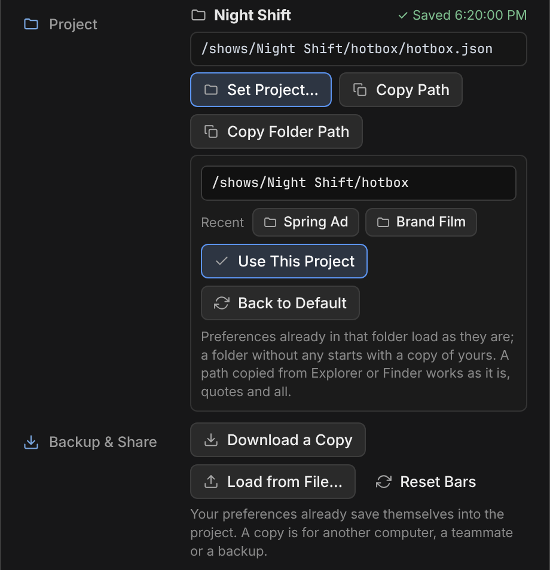

# Hotbox reference

Everything Hotbox does, bar by bar. For a quick look start with the [README](../README.md); for a step-by-step walk, the [tutorial](../TUTORIAL.md).

---

## ✨ Highlights

- **Three styles** (switch live with <kbd>Tab</kbd>):
  - **Compact** (default) — the Fluid look and motion, bars only (no side cards).
  - **Fluid** — frosted glass panels, spring motion that blooms from the cursor, sliding hover highlights and smooth sliders.
  - **Quiet** — native ComfyUI panels, monospace key hints, fast fades (optional leader lines from the cursor to each zone).
- **The big blue `+`** sits right beside the bottom bar. Hover it and the four categories fan out (`All Nodes F` · `Image / Video Kit N` · `Models & APIs A` · `Subgraphs U`); click it for All Nodes. Drag any result onto any bar to pin it, or **drop it on the `+`** to pin it to the bottom bar.
- **A search that ranks like ComfyUI's.** The drawer's search grades each node the way ComfyUI's own search box does (the whole name, its start, a whole word, part of a word, every word you typed), then puts ComfyUI's own nodes before custom ones, the nodes that take the node's outputs next (with their slot shown, `IMAGE`), then the ones people use most (the popularity list ComfyUI ships). Typos (`previw`), short forms (`load img`, `ckpt`, `i2v`) and the node's search aliases still find it. A custom node shows its pack's name beside it. <kbd>↑</kbd> <kbd>↓</kbd> pick a result, <kbd>Enter</kbd> adds it, <kbd>Esc</kbd> clears the search, then closes the drawer.
- **Only the newest models.** Deprecated and legacy nodes never show up, and neither do older versions of a partner model when its newer one is installed: Kling 4.0 hides Kling 3.0 Omni, Kling 2.6 and the first Kling; Vidu Q4 hides Vidu2; Seedance 2.5 hides the first ByteDance video nodes; ComfyUI's Image to Video (LTX-2.5) subgraph hides the LTX-2.3 one. Type a version number to find an older one (`kling 2.6`). A button you already pinned stays, and local model nodes are never hidden (an older model on disk needs its own nodes).
- **A dock shortcut you choose.** The button at the end of the top dock opens one category (Models by default); its `▾` swaps it for the Kit, Subgraphs or All Nodes — or hides it.
- **Drag a node onto the bar to pin it.** Grab any node by its title while the hotbox is open and drop it on the bottom bar (or the `+`). The node stays where it was; its type becomes a one-click button for that context.
- **Save as Button.** Select any nodes (one or many, or a group) and press **Save as Button** (<kbd>X</kbd>): a copy of them melts into one button in the bottom bar, and the nodes themselves stay where they are. Click the button to add those nodes again by the cursor, or drag it onto the canvas to add them right there — settings and inner wires come back exactly as they were. The button is named after what the nodes do (`Flux · Text to Image`, `Wan · Image to Video`, `Upscale`…) and saved with the rest of your preferences. Select a label along with the nodes and the button takes the label's text as its name: the name you already wrote on the canvas (a Label Studio / rgthree label or a Pixaroma label; with several, the top one). A titled group names it when no label is selected, and a label inside a group names it when the group has no title.
- **Change what a saved button holds, and keep the button.** No need to save a new one, rename it and put it in the old one's place: the button stays where it is, with its name, color and key.
  - **Use selection.** Change the nodes on the canvas, select them, right-click the button and choose **Use selection**: the button takes them instead of the ones it held (it asks for a second click).
  - **Edit its nodes.** Right-click the button → **Edit its nodes…** (or the pencil on its card in the button browser) opens what it holds: pick a node and change its values, its title or how it runs (normally, muted, bypassed), or take the node out of the button; **JSON** shows the node, or the whole button, as ComfyUI copies it, to edit by hand (it is checked before it is kept). **Put on canvas** adds the nodes to the canvas to change them there. **Save to this button** keeps it.
  - **Versions.** What a button held before is kept behind it (the last five): **Versions…** in that editor brings one back. A button in a writable shared library is written back into its folder (it keeps no versions there).
- **Button browser.** **Settings → Saved Buttons → Browse…** opens every saved button and every group on cards: its name, color and key, how many nodes it holds and which, and the group it is in. Click a card for Edit Button; drag a button onto a group to put it in, and out of it (or its ×) to take it out; **New Group** makes an empty one in the bottom bar; **Ungroup** gives a group's buttons back to its bar; the pencil opens a button's nodes and the trash deletes it. Every change saves itself, and **Undo** (<kbd>Ctrl</kbd>+<kbd>Z</kbd>) takes it back, a deleted button too.
- **Button groups.** Drag a button over the middle of another and rest there a moment: the other one lights up, and letting go makes the two a group, with a little pop (a button only passing over another just moves to that side of it). Drop more buttons on the group to fill it. Hover a group and its buttons drop down in a list under it, one after another (a soft spring in Fluid, little balloons in Compact, a quiet slide in Quiet); its arrow keeps it open until the hotbox closes, and a second click closes it. With the list open, a button goes to any place in it, the first one too: the empty slot shows where. Click the group in edit mode (or right-click it any time) to rename it. Drag a button from the list onto the bar to take it out; × on the group ungroups it and its buttons stay in the bar. A group left with one button, or none, asks before it goes: **Keep group** leaves it in the bar with its name and color, empty too, ready to be filled again (its × removes it); **Remove group** unfolds it, and its last button goes back to the bar. <kbd>Enter</kbd>, <kbd>Esc</kbd> or a click outside keep it, so a group is never lost by accident.
- **Group with `G`.** Press <kbd>G</kbd> in the hotbox to group the selection (or the node under the cursor). It uses ComfyUI's own Group Selected Nodes, so the title editor opens right away, already holding a name read from the nodes, like a saved button's.
- **Swap Nodes.** Select two nodes and press **Swap Nodes** (<kbd>W</kbd>): they trade places and wires.
- **Replicate.** Select a group (with its label) or any nodes and press **Replicate**: choose how many copies (up to `Z`), below or to the right, and each copy moves the letter on, A → B, C, D…, in its group titles, labels, Set / Get names, texts and file names (`Crop_A_v` → `Crop_B_v`, Save Video, Save EXR, OCIO Read / Write paths like `shot_A.####.exr`). Only a letter standing on its own moves (`Group_A`, `crop A`, `A01`), never one inside a word, a code or a prompt's "A woman…". A file picked from a list moves on when that file is there (`jacket_A.png` → `jacket_B.png`). The dialog lists every name that will move, each one can be switched off, and a number can be switched on too (`REFERENCE IMAGE_1` → `_2`, `_3`…; a Get only moves to a Set that exists). A Get of a Set copied with it follows its Set. Wires coming in from outside stay plugged into the same nodes, **A color per copy** gives each copy's groups and labels its letter's color, and one <kbd>Ctrl</kbd>+<kbd>Z</kbd> takes all the copies back.
- **Customize every bar.** Long-press any button (or click the ✎ icon) to enter edit mode: **Editing** shows in the edit bar and a fine line goes around every bar, and nothing moves (Settings → Edit Mode brings back an outline, a tilt, a float or the jiggle). A press held with a slightly shaky hand is still a press.
  - **Move a button anywhere.** Drag it: the button lifts, a little bigger and with a shadow, and an empty slot shows where it will land, in any bar or in an open group's list. Let go away from the bars and it goes back where it was: nothing is removed by a drag that missed.
  - **Take a button off its bar** with its **×**, or drop it on the edit bar, which is a red **Drop here to remove** strip while a button is in the hand.
  - **Undo.** <kbd>Ctrl</kbd>+<kbd>Z</kbd> (or **Undo** in the edit bar) takes back the last change to the bars, the groups and the saved buttons, one step at a time.
  - **Edit Button.** Click a button in edit mode, or right-click it any time: its name; a color, in the same seven colors as the node swatches, so a button is easy to find at a glance (nodes keep their own colors); **Paint**, which chooses where the color goes (**Mark** colors only the button's dot, icon or number, **Whole button** gives the whole button a soft shade of it); and a **Key** of its own. **Reset** there brings back the button's own name and color, and clears its key.
  - **A key of its own.** In Edit Button, click **Key** and press one key (a letter, a number, a sign or <kbd>F1</kbd>–<kbd>F12</kbd>; <kbd>Backspace</kbd> clears it). The button answers to it while the hotbox is open and the button shows, in a bar or inside a group. A button that came with a key (its number in the dock, a tool's letter) lets go of the old one, and the box says so when the key already does something else or belongs to another button, which then loses it.
  - One name and one color per button: what you set on a bar is what Settings, the drawer and the button browser show.

  **Reset** in the edit bar restores the defaults, **Done** / <kbd>Esc</kbd> / a click on the canvas exits. Edit mode starts with the very same buttons, right where they were, so the one under the pointer is still there and can be dragged with the same press. The buttons a bar holds that do not apply to the node under the hotbox stay hidden until you click **+N hidden here** in the edit bar; show them to move, rename or remove them too.
- **Works with both node renderers** — Nodes 2.0 (Vue) and the classic LiteGraph canvas.

---

## 🧭 Layout

| Zone | What lives there |
| :--- | :--- |
| **Top dock** | `[1]`–`[5]` smart suggestions for the node under the cursor (they add & auto-wire, or *swap* when an API/model node is selected: then a teal **SWAP** tag leads the dock and each button that swaps has a teal number; a node you pinned there yourself stays gray, because it adds one more) + your dock shortcut (`★ Models ▾` by default). |
| **Context bar** | Tools for the node type — e.g. on a crop node: **Visual Crop `Z`**, **Super Stitch** and an aspect-ratio switch (`Free · 1:1 · 16:9 · 9:16 · 4:3 · 3:4`). On a `Label (rgthree)` it becomes the **Label bar**: text, color, quick icon, top shine, corners, size, spacing and font, all live. On a Set node it starts with a **Name** field: type the name and press <kbd>Enter</kbd> (<kbd>Esc</kbd> undoes); its Gets follow the new name, and a name already in use gets `_0`. Extensions can add their own controls here too ([CUSTOM_BAR.md](../CUSTOM_BAR.md)). |
| **Left card** | `Rename F2` · `Add Label L` · `Magnifier / Visual Crop / Paint Z` · `Add Reroute R` · `Set / Get Bus S` · `Group G` + node color swatches and a custom color picker. On the bare canvas it lists a **Get** for every Set bus in the workflow, dropped where you opened the hotbox. |
| **Right card** | **Pro Sliders** for the node's numeric widgets (drag to scrub, <kbd>Shift</kbd> fine, <kbd>Ctrl</kbd>+click previous value, double-click default, wheel to nudge, click the value to type). Four show at once; more scroll inside the card. |
| **Custom Bar** | Controls other extensions hand to the hotbox, right above the bottom bar (see [Custom Bar](#-custom-bar-for-extension-authors)). Not there when nothing registered one. |
| **Bottom bar** | `Load in Canvas V` (on Preview, Save Image and Save Video nodes) · `Preview T` · `Seed mode P` · `Bypass B` · `Zoom .` · `Bypass All APIs K` (when the workflow has API nodes) · `Swap Nodes W` (two nodes selected) · `Save as Button X` · `Render Selected ⇧R` + your pinned nodes and saved buttons, the edit and settings buttons, and the `+` with its category dial. |

---

## 🧠 Context-aware behavior

- **Empty canvas** — quick spawners (`Load Image`, `Load Checkpoint`, `KSampler`, …) and labels.
- **Any node** — the dock suggests nodes that accept its outputs (multi-slot aware: a checkpoint loader suggests nodes for `MODEL` *and* `CLIP`) and wires them on click. A source that offers the same picture two ways is wired once: from an OCIO Read (or any node with both an IMAGE and a VIDEO output), a sequence or a clip goes into the new node's video input and a still into its image input. Side data such as fps, info or metadata only goes into an input of the same name (fps and metadata into OCIO Write), never into a prompt, and an alpha is left for you to wire. It never offers the node you are standing on again, unless it is the kind that chains (LoRA loaders, ControlNet apply, conditioning combine…), and it never offers deprecated nodes. A **LoRA** added after a checkpoint or another LoRA joins the chain: it takes their `MODEL` and `CLIP`, and whatever they fed now hangs off the new LoRA. New nodes never land on another node: they step right or down, whichever is shorter.
- **API nodes and subgraphs** — saving comes first: **Save Video** when they output video, **Save Image** / Preview when they output images. Video and image generators keep separate bars, and a model only swaps to models of the same kind.
- **Image / video loaders** — `[1]`–`[5]` add the model to the right and auto-wire `IMAGE` / `VIDEO` / `MASK`. A `LoadImage` node also offers **Read PNG metadata** (load workflow, copy seed).
- **Two loaders selected** — the model is wired to both (reference + target / first + last frame), plus **Compare A/B**.
- **Model / API node selected** — `[1]`–`[5]` **swap the model in place** (the new node keeps the old one's spot), carrying over shared widgets (`prompt`, `seed`, `aspect_ratio`, …) and reconnecting links. With several nodes selected, every selected node of the same model swaps at once, each with its own prompt and wires.
- **Crop node** — **Visual Crop editor** and **Super Stitch** (below).
- **Stitch node** — **Update Stitch** (re-read the crop) and **Swap FG / BG**.

### Super Stitch
Press it on a crop, on the plate it cuts, or on a result that came out of a crop. It adds a **fit** (`ImageScale`, bicubic, crop disabled) that sizes your result back to the crop box, and an `ImageCompositeMasked` that pastes it at the crop's `x / y` with the plate as destination. Several crops of one plate make **one chain**, a crop is never stitched twice, a preview closes the chain, and every stitch **keeps following its crop** when you move or resize it. On a result that came out of a crop, Super Stitch is the **first button of the Context bar** and plugs that result in by itself; the chain sits right after it. Pressed on a crop before there is a result, an empty **apinode / localmodel** group marks where the model goes. Either way the new chain is brought into view.

### Save as Button
The animation follows your style: **Fluid** pulls the nodes together into one card that falls into the bar, **Compact** shrinks the selection box into the button, **Quiet** dissolves the nodes into a soft bloom. Adding them back follows it too: **Fluid** springs the nodes out of the button one after another, **Compact** inflates them in place like little balloons with a soft bounce, **Quiet** just pops them in. Nothing is deleted: the nodes step aside while the button forms and come back once it lands. Every saved button is listed in **Settings → Saved Buttons** and under **Saved Buttons** in the Tools drawer, where it can be dragged onto any bar or onto the canvas, or deleted (two clicks on the trash). Rename one in edit mode.

**Buttons are modules.** With one node selected, a saved button whose block starts with an open input (say `Crop → Preview`, or `Nano Banana 2 → Save`) lands right after that node and plugs the node's output into that input, so small saved blocks chain into a whole pipeline one click at a time. A block that starts with its own loader is just added. Wires into the image slots of the newer API nodes, which a plain paste can drop, come back too.

### Image & Video Kit (`N`)
Crop (+ preview), Super Stitch, Resize (`ImageResizeKJv2`, `ImageResize+`, `ImageScaleBy`, `ImageScale`), Flip, Paint Mask/Plate, Compare A/B, Preview / Save Image, Framehold, Video → Frames, Create Video, Save Video, Set / Get nodes, Reroutes and labels — each spawned and wired to the current selection in one click.

---

## ⌨️ Shortcuts

| Shortcut | Action |
| :--- | :--- |
| <kbd>`</kbd> | Open / close the hotbox (rebindable; toggle or hold-and-release mode). |
| <kbd>Tab</kbd> | Switch style (Fluid → Compact → Quiet) while the hotbox is open. |
| <kbd>1</kbd>–<kbd>9</kbd> | Run the matching dock button. |
| <kbd>+</kbd> / <kbd>F</kbd> · <kbd>N</kbd> · <kbd>A</kbd> · <kbd>U</kbd> | Add drawer: all nodes · image/video kit · models & APIs · subgraphs. |
| <kbd>↑</kbd> <kbd>↓</kbd> · <kbd>Enter</kbd> · <kbd>Esc</kbd> | In the drawer's search: pick a result · add it · clear the search (again: close the drawer). |
| <kbd>G</kbd> | Group the selection (or the node under the cursor) and name it. |
| <kbd>Esc</kbd> | Leave edit mode, or close the hotbox. |
| <kbd>Ctrl</kbd>+<kbd>Z</kbd> | In edit mode and in the button browser: take back the last change to the bars, groups and saved buttons. |
| a key of your own | Any bar button can have one: right-click it → **Key**. |
| <kbd>Alt</kbd>+<kbd>Z</kbd> | **Magnifier** — big live prompt editor · **Visual Crop editor** on crop nodes · **Paint Studio** on paint / `LoadImage` nodes. |
| <kbd>Alt</kbd>+<kbd>N</kbd> | **Label Studio** — rich canvas titles/notes (`Label (rgthree)` when installed, otherwise `MarkdownNote` / `Note` / `Group`). |
| <kbd>Alt</kbd>+<kbd>R</kbd> | **Load in Canvas** — hand the selected node's render to a new `Load Image` (or `Load Video` for videos). |
| <kbd>Shift</kbd>+<kbd>R</kbd> | **Render Selected** — queue only the selected output nodes (or the outputs downstream of the selection). Nothing selected renders nothing. |
| <kbd>.</kbd> | Frame the selected node(s); press again to return to the previous view. |
| <kbd>L</kbd> | Arrange the selected nodes along their wires (Nuke's <kbd>L</kbd>); one node lines up with the node that feeds it. With the hotbox open, <kbd>L</kbd> is Add Label. |

While the hotbox is open it owns these keys, so other extensions (or ComfyUI keybindings) on the same keys don't fire at the same time.

### Power Tools
Magnifier / Visual Crop / Paint Studio, Label Studio, Load in Canvas, Render Selected, Super Stitch, Swap Nodes, Save as Button, Bypass All APIs, Zoom to Selection, Arrange Nodes, Replicate and Copy Workflow (the whole workflow on the clipboard, as Export saves it; <kbd>Ctrl</kbd>+<kbd>V</kbd> on any ComfyUI canvas opens it) are listed in **Settings → Power Tools** (hover one for what it does). **Drag any of them straight onto any hotbox bar**, saved buttons too (from **Settings → Saved Buttons**). What you place stays where you put it: on a node it does not work on (Swap Nodes with one node selected, Load in Canvas on a Load Image) it is dimmed, and a click says when it works. The bottom bar is the same on every node; the top bar and the context bar are kept per kind of node, so a button placed there shows on nodes like the one it was placed on. The buttons that come with Hotbox still show only where they apply, so the bars stay short, and editing a bar on one node never moves the buttons hidden there.

---

## ⚙️ Settings

The **H** button in ComfyUI's top bar: click it for settings (hotkey, toggle vs. hold, style, edit-mode animation, canvas dim or leader lines, glass blur, UI scale, bar spacing, power tools, saved buttons and groups with the button browser, where your preferences are saved), right-click it to enable or disable the hotbox.

**Glass Blur** (Fluid and Compact) is the frosted glass behind the bars and cards. It asks a lot of a browser that draws without a graphics card (a remote desktop, some Linux workstations): switched off, the bars are plain panels.

Compact is the style Hotbox opens in. Preferences saved with Fluid before 1.2.9 open in Compact once, since nothing in them tells a Fluid that was chosen from one that was just the default: <kbd>Tab</kbd> (or **UI Style** here) brings Fluid back, and from then on it stays.

---

## 📁 Your preferences file
Everything you change — moved and pinned buttons, bars, labels, saved buttons and settings — is saved to one file:

```
Linux            ~/comfyui/hotbox/hotbox.json
Windows, macOS   ComfyUI/user/default/hotbox/hotbox.json
```

On Linux it sits in your home folder, outside ComfyUI, so reinstalling or moving ComfyUI never touches it; whatever an older Hotbox saved in ComfyUI's user folder is copied there the first time (the old files stay where they were). A ComfyUI shared by several users (`--multi-user`) keeps one folder per user in its user folder instead. To choose the default yourself on any system, set `HOTBOX_DIR` to a full path before starting ComfyUI (`export HOTBOX_DIR=/mnt/studio/hotbox/$USER`).

Because it lives on disk (not in the browser), your setup follows you to any browser and survives clearing the cache.

### Projects


The folder your preferences live in is the **project**. **Settings → Project** shows its name (the folder's, or `Default`) and the full path of the file (**Copy Path** and **Copy Folder Path** put it on the clipboard).

**Set Project…** points Hotbox at any other folder (one per show, a synced drive, a team folder…): preferences already in it load right away; a folder without any starts with a copy of yours. A path copied from Explorer or Finder works as it is, quotes and all, and so does the path of a `hotbox.json`. A folder called `hotbox` is named after the folder above it (`MyShow/hotbox` is the `MyShow` project). The projects you used last show up under **Recent**, one click each, and **Back to Default** returns to the default folder. The choice and the recent list are kept in `folder.json` in the default folder.

### Backup & Share
Your preferences save themselves into the project on every change; these are for another computer, a teammate or a backup.

- **Download a Copy** downloads the preferences in use as a dated file (`hotbox_original_2026-10-22_0915.json`). Nothing changes in Hotbox.
- **Load from File…** opens a Hotbox `.json` and never overwrites anything. Choose:
  - **Use it in this project**: it is added as a **new version** (`hotbox_v2.json`, `hotbox_v3.json`, …) and used right away. `hotbox.json` stays your **Original**, and **Settings → Version** steps back to it any time.
  - **Set a project for it…**: pick a folder (or a **Recent** one) and Hotbox switches to it with these preferences. In an empty folder they become its `hotbox.json`; a folder that already has preferences keeps them and gets the file as its next version.
- **Reset Bars** puts every bar back to its default buttons (saved buttons stay saved).

A browser that still has preferences from an older Hotbox moves them into the file the first time it loads.

### A ComfyUI shared by many people
On a ComfyUI that everyone logs into as the same user, one user folder cannot tell people apart, and the Python side may not be installed at all. A page that carries Hotbox there can keep the files itself: it sets `window.__hotboxFiles` before Hotbox loads, and Hotbox then reads and writes only through it, never in ComfyUI's user folder.

```js
window.__hotboxFiles = {
  folder: () => Promise,        // { folder, sep, ready, why }: ready false = the files cannot be reached now, why says so
  read:   (name) => Promise,    // the parsed file, null when it does not exist yet
  write:  (name, obj) => Promise,
  list:   () => Promise         // the file names in the folder
};
```

While `ready` is false Hotbox keeps working from this browser's copy and Settings shows `why`. Call `window.__hotbox.filesChanged()` when the files can be reached, or no longer: what changed in the meantime is written to the file, otherwise the file is read.

## 🗂️ Shared libraries
A shared library is another folder of saved buttons (a studio's shared drive, one folder per show) whose buttons show up beside your own: in the <kbd>N</kbd> drawer, grouped by library, and in **Settings → Saved Buttons**, ready to drag onto any bar.

- **Settings → Shared Libraries → Add Folder** takes a full path. A library starts **Read-only** (its buttons are used, never changed); make it **Writable** and **Save Here** to send the buttons you save with <kbd>X</kbd> into it for everyone who has it.
- Each button is its own `<id>.json` file in the folder, so a synced drive (Google Drive, Dropbox, a NAS, a Git repository) never has two people writing the same file. A `hotbox.json` in the folder (someone's whole Hotbox folder) is read too.
- The libraries are read again each time the hotbox opens, so a button a teammate just saved shows up without reloading. A folder that is not there right now (a drive not mounted) hides its buttons and stays on the list.
- The list is kept in `libraries.json` next to your `hotbox.json`.

For a tool that follows the shot you are on, the list can be set without Settings:

```
POST /hotbox/libraries   { "add": [{ "path": "/shows/ABC/hotbox", "label": "ABC", "readOnly": false }], "remove": ["/shows/XYZ/hotbox"] }
GET  /hotbox/libraries   (?buttons=1 to include them)
```

or from the page: `window.__hotbox.addLibrary(path, { label, readOnly })`, `window.__hotbox.removeLibrary(path)` and `window.__hotbox.libraries()`. A studio can also set the `HOTBOX_EXTRA_PATHS` environment variable (folders separated like `PATH`) before starting ComfyUI: those are always read-only and marked **Studio**.

Which folders Hotbox uses is decided on the computer running ComfyUI: **Set Project** and the list of libraries change only from that computer (a loopback address, or ComfyUI's own address). From another computer, or through a proxy, those requests answer `403`, so a ComfyUI started with `--listen` never lets someone else point Hotbox at a folder; everything else keeps working there, inside the folders already set. A button saved into a library only ever replaces another Hotbox button: any other file of the same name is left alone.

## 📦 Sharing buttons from a page
A page that runs beside Hotbox (a studio panel, another extension) can let someone pick groups and saved buttons, carry them to another person however it likes, and hand them to that person's Hotbox, which adds them to what is there. Hotbox only packs and unpacks: it knows nothing of who carries the pack, or how.

```js
window.__hotbox.shareable()
// → { groups:  [{ id, name, count, color, items: [{ uid, label }] }],
//     buttons: [{ id, name, count, at, lib: '<library label>' | '', color }] }
// Your groups and saved buttons (a shared library's too, marked with lib), named as the bars show them.

window.__hotbox.pack(uids)          // uids: 'grp:<id>' and / or 'tpl:<id>'
// → plain JSON:
//   { hotbox_pack: 1, hotbox: '1.2.9',
//     groups:    [{ id, name, items: [uid…] }],
//     templates: [{ id, name, count, at, data }],   // each saved button with its nodes
//     labels: { uid: name }, colors: { uid: … }, fill: { uid: true }, keys: { uid: key } }

window.__hotbox.addPack(pack, { from: 'ana' })
// → Promise { file: 'hotbox_v4.json', version: 'Version 4',
//             added: { groups, buttons }, replaced: { groups, buttons } }
```

- A group travels with its buttons. Its saved buttons go into `templates`; its tools, nodes and models travel by name, since every Hotbox has them. A shared library's button becomes a button of one's own (`tpl:<id>`): whoever gets it may not have that library.
- `addPack` never overwrites the file in use. It writes what is pending to that file first, adds the pack to the preferences, and keeps the result as the **next version** (`hotbox_v2.json`, …), used right away: **Settings → Version** goes back any time.
- A saved button or a group with the **same id** takes the place of the one that was there, where it was: it is the same button, sent again after a change. The button it replaced stays behind it as a version. A new one goes to the end of the bottom bar (a new button that came inside a group shows in its group).
- A saved button and a group bring their name, color and key. For a tool or a node, the name, color and key you gave it yourself stay, and a key another of your buttons already has is not taken.
- The promise is **rejected**, and nothing is written, when the pack is not one (`hotbox_pack` missing, or nothing in it) or when the files cannot be reached (ComfyUI not answering, or `window.__hotboxFiles` not ready): the message says why, so the page can try again later.

`window.__hotbox.browseButtons()` opens the button browser, and `window.__hotbox.editButton(id)` the nodes of one saved button.

> Upgrading from *Super Hotbox*? Your settings are picked up automatically. Remove the old `super_hotbox` folder from `custom_nodes` so the two don't load side by side.

---

## 🧩 Custom Bar (for extension authors)

Any extension can put its own controls in the hotbox, drawn in the hotbox style: buttons, groups with a caption, folds that open a tray or a second row, menus with a filter, selects, text and number fields (with ▲ ▼), sliders, color swatches, segmented switches, toggles and info text. They go in the **Custom Bar** (right above the bottom bar) or in the **Context bar** (`where: 'context'`), and follow the current style.

```js
window.__hotboxBars = window.__hotboxBars || {};
window.__hotboxBars['my-tool'] = {
  name: 'My Tool',                       // small tag at the start of the row (optional)
  where: 'bottom',                       // or 'context'
  items: function (ctx) {                // asked every time the hotbox paints
    if (!ctx.node) return [];            // ctx.node: the node under the hotbox · ctx.nodes: the selection
    return [
      { type: 'group', label: 'output', items: [
        { label: 'exr', icon: 'save', run: function () { /* … */ } },
        { label: 'image', icon: 'save', run: function () { /* … */ } }
      ] },
      { type: 'select', icon: 'seed', value: 'randomize', options: ['fixed', 'increment', 'decrement', 'randomize'],
        onChange: function (mode) { /* … */ } }
    ];
  }
};
```

The whole contract (every item type, how each one behaves, icons, style rules and a worked example) is in **[CUSTOM_BAR.md](../CUSTOM_BAR.md)**. Hotbox also fires `hotbox:open` and `hotbox:close` on `window`, so a tool that shows the same buttons elsewhere can step aside while the hotbox is up.

---

## 🛠️ Development

Everything is in [`js/hotbox.js`](../js/hotbox.js): plain ES5-style JavaScript, DOM built from strings, styles injected as one stylesheet, motion done with CSS transitions and the Web Animations API. No build step — edit, refresh the browser. [`hotbox_files.py`](../hotbox_files.py) serves the preferences folder (restart ComfyUI after changing it); without it Hotbox falls back to ComfyUI's user-data API.
